# conformal-forecast

Time-series forecasting models that don't just give you a number — they give
you a **calibrated uncertainty interval**, and this repo actually checks that
the calibration works instead of just asserting it.

Most small forecasting projects stop at "here's my model's MAE." This one
answers a different, arguably more useful question for anyone deploying a
forecast: *if the model says "90% confidence interval," does the true value
actually land inside that interval about 90% of the time?* That property is
called **coverage**, and it's what [conformal prediction](https://en.wikipedia.org/wiki/Conformal_prediction)
is designed to guarantee — with a real statistical argument behind it, not a
hand-wavy confidence score.

## What's in here

- **Five point-forecast models**, all behind the same `fit`/`predict`
  interface: `Naive`, `SeasonalNaive`, a from-scratch PyTorch `LSTM`,
  (v0.20) a from-scratch PyTorch `Transformer` encoder, and (v0.23) a
  from-scratch generic `N-BEATS` (Oreshkin et al. 2020) stacked-block
  architecture with explicit backcast/forecast residual stacking
  (`forecasting/models.py`) — three architecturally distinct neural models
  (recurrence / self-attention / stacked-FC-with-residual-basis-expansion),
  trained with the identical recipe, so a benchmark comparison isolates
  architecture from training.
- **A `DeltaWrapper`** that turns any point model into one that predicts the
  *change* from the last observation instead of the absolute level — the
  neural-net analogue of ARIMA's differencing term, needed because a small
  LSTM can't extrapolate a trend it never saw the level of during training
  (see the docstring in `forecasting/models.py` for why, and the benchmark
  below for what happens without it).
- **Split conformal prediction** (`forecasting/conformal.py`) wrapping any of
  the above to produce a calibrated `[lower, upper]` interval, using the
  finite-sample-corrected quantile from Lei et al. (2018) / Vovk et al.
  (2005) — not a bootstrapped or "eyeballed" interval.
- **Adaptive Conformal Inference** (`forecasting/adaptive.py`, Gibbs & Candès
  2021) as a direct follow-up to the LSTM under-coverage finding below: an
  online method that widens or tightens the interval each step based on
  whether the previous one covered the truth, with no exchangeability
  assumption. Implemented, tested against its own statistical claim, *and*
  benchmarked honestly against static split conformal — including the real
  case where it doesn't help much (see "Adaptive Conformal Inference"
  below).
- **A sliding/growing-pool ACI variant** (`forecasting/adaptive.py`,
  `SlidingWindowAdaptiveConformalForecaster`) that fixes exactly the gap the
  first ACI implementation left open: instead of only re-slicing a frozen
  calibration pool, it folds each test step's own observed residual into the
  pool once that step has been scored, removing the "can never propose an
  interval wider than the calibration set's own max residual" ceiling. This
  is what actually recovers real coverage on the airline dataset (see
  "Sliding/growing-pool ACI" below) — the fixed-pool variant alone could not.
- **A window-size sweep for the sliding-pool variant**
  (`forecasting/experiment.py`, `run_window_sweep_comparison`) that answers
  the fixed-pool variant's own "what's next" question honestly: is the
  unbounded growing buffer actually the best choice, or does bounding it
  help? (See "Window tuning" below — the answer is genuinely interesting,
  and finding it surfaced a real bug in the first cut of the sliding-window
  implementation, fixed in the same run.)
- **EnbPI** (`forecasting/enbpi.py`, Xu & Xie 2021) — a structurally
  different answer to the same exchangeability problem: instead of adapting
  one model's significance level online, it trains a bootstrap ensemble
  once and slides an out-of-bag residual pool forward. On the exact airline
  case the ACI sections above were built around, a bounded ensemble (20
  members, `window=10`) outperforms *both* ACI variants already shipped for
  this model/dataset (see "EnbPI" below) — found via a real swept-then-
  measured `window` search, not a single lucky setting.
- **A test suite that checks the statistical claim, not just that the code
  runs** (`tests/test_conformal.py`, `tests/test_adaptive.py`,
  `tests/test_adaptive_experiment.py`, `tests/test_sliding_window.py`,
  `tests/test_sliding_window_experiment.py`, `tests/test_window_sweep.py`,
  `tests/test_enbpi.py`, `tests/test_enbpi_experiment.py`):
  on synthetic data with known
  noise, it verifies empirical coverage actually tracks the nominal target
  across multiple seeds and confidence levels, and that both ACI variants
  measurably reduce a coverage gap under genuine, constructed distribution
  drift — with the sliding/growing-pool variant checked against the
  fixed-pool variant's own numbers, not just against doing nothing.
- **Two real, public benchmark datasets** bundled in `data/` (no network
  access needed to reproduce results) plus a synthetic generator for
  controlled calibration testing.

## Why conformal prediction, and why be honest about its limits

The textbook coverage guarantee for split conformal prediction assumes the
calibration-set residuals and the test-set residuals are *exchangeable*. For
a genuinely non-stationary series, or a model whose error pattern drifts
between the calibration and test windows, that assumption is only
approximate — and this project doesn't paper over that. The benchmark below
includes a case where it visibly breaks down, and says so.

## Benchmark results

Generated by actually running `python -m forecasting.cli benchmark` — every
number below came out of that command, not out of a spreadsheet.

### airline (nominal 90% intervals)

Classic Box & Jenkins monthly airline passenger counts, 1949-1960 (144
points, strong trend + yearly seasonality, almost no noise).

| Model | MAE | RMSE | MAPE (%) | Empirical coverage | Mean interval width |
|---|---|---|---|---|---|
| Naive | 45.100 | 52.612 | 10.30 | 80.0% | 2.270 |
| SeasonalNaive | 40.800 | 45.555 | 9.02 | 86.7% | 1.999 |
| LSTM (delta) | 122.645 | 134.268 | 27.76 | 63.3% | 4.873 |
| Transformer (delta) | 36.276 | 44.416 | 8.22 | 66.7% | 1.509 |
| N-BEATS (delta) | 45.260 | 49.689 | 10.64 | 56.7% | 1.484 |

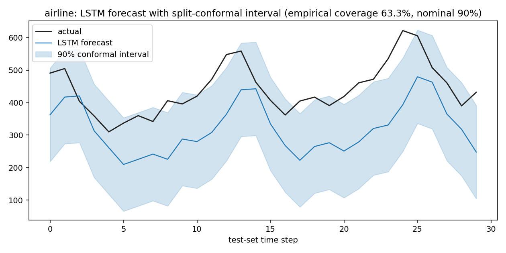

**Honest finding, not a hidden one:** on this dataset the from-scratch LSTM
*loses* to both baselines, and its 90%-nominal interval only actually covers
63.3% of test points. Looking at the plot, the LSTM is systematically
under-predicting during the second half of the test period — with only ~86
training windows (144 points, 60% train split, lookback 12), there simply
isn't enough data for a neural model to reliably beat a strong seasonal
baseline, and the reason the intervals under-cover is that this makes the
model's own error grow between the calibration window and the test window —
exactly the exchangeability failure mode described above, made visible with
real numbers instead of asserted away. This is a well-known result in
forecasting benchmarks (simple baselines are hard to beat on short series);
reporting a loss here is more trustworthy than only ever showing wins.

**The Transformer (v0.20) tells a more nuanced story, not a uniformly better
one — see "More model families" below for the full honest read:** it beats
every other model here on every point-accuracy column, including both
baselines (36.3 MAE vs. SeasonalNaive's 40.8), but its interval still
under-covers (66.7% vs. 90% nominal) — a real, measured improvement over the
LSTM's under-coverage (63.3%), not a fix of it.

**N-BEATS (v0.23), the third architecture, is the honest disappointment of
the three here — see "More model families" below for the full read:** its
point accuracy (45.3 MAE) lands close to `SeasonalNaive`'s and well behind
the Transformer's, and its coverage (56.7%) is the *worst* of all five rows
in this table, including the LSTM it was meant to compare against. Reported
as measured, not reframed — this benchmark isn't a showcase for N-BEATS, it's
a real answer to whether it generalizes better here (it doesn't, in this
configuration).

### daily-min-temperatures (nominal 90% intervals)

Daily minimum temperatures in Melbourne, Australia, 1981-1990 (3650 points,
strong yearly seasonality, substantial day-to-day noise).

| Model | MAE | RMSE | MAPE (%) | Empirical coverage | Mean interval width |
|---|---|---|---|---|---|
| Naive | 1.953 | 2.481 | 21.23 | 93.6% | 2.163 |
| SeasonalNaive | 1.953 | 2.481 | 21.23 | 93.6% | 2.163 |
| LSTM (delta) | 1.730 | 2.199 | 20.68 | 93.0% | 1.929 |
| Transformer (delta) | 1.721 | 2.197 | 20.42 | 92.9% | 1.941 |
| N-BEATS (delta) | 1.758 | 2.245 | 20.80 | 92.3% | 1.970 |

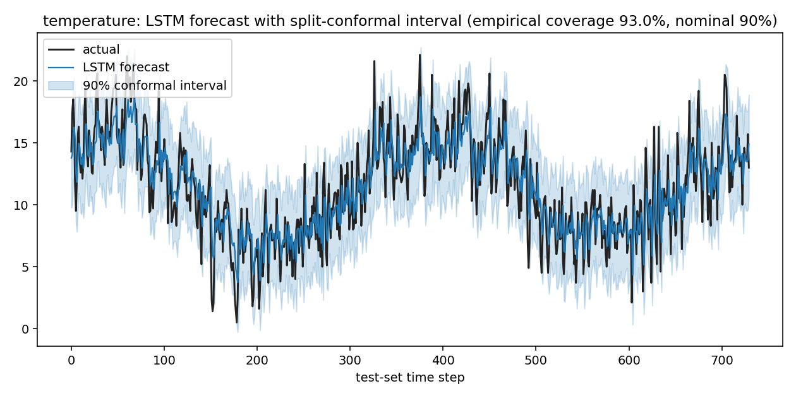

Here the LSTM has ~1950 training windows to work with (vs. ~86 for airline)
and modestly beats both baselines on every point-accuracy metric, while
coverage stays close to nominal for all three models. `SeasonalNaive`
matches `Naive` exactly here because the default 30-day lookback is shorter
than the 365-day yearly period, so it falls back to the last-value rule (see
`SeasonalNaiveForecaster` in `forecasting/models.py`) — we also tried a true
365-day lookback out of curiosity and found day-to-day persistence actually
beats same-day-last-year for this series (MAE 1.95 vs 2.97), which is why
the shorter default lookback isn't just a shortcut, it's the better choice
here too.

### synthetic (known noise, nominal 90% intervals — the calibration sanity check)

Trend + seasonality + i.i.d. Gaussian noise with known std, used specifically
to validate the conformal machinery itself:

| Model | MAE | RMSE | MAPE (%) | Empirical coverage | Mean interval width |
|---|---|---|---|---|---|
| Naive | 1.910 | 2.350 | 2.24 | 87.5% | 0.755 |
| SeasonalNaive | 1.515 | 1.847 | 1.77 | 90.0% | 0.608 |
| LSTM (delta) | 1.978 | 2.425 | 2.32 | 63.7% | 0.471 |
| Transformer (delta) | 1.556 | 1.905 | 1.83 | 81.2% | 0.491 |
| N-BEATS (delta) | 2.240 | 2.639 | 2.60 | 58.1% | 0.531 |

The `Naive`/`SeasonalNaive` rows land close to the 90% nominal target, which
is what `tests/test_conformal.py::test_empirical_coverage_tracks_nominal_on_synthetic_data`
checks automatically (across 4 seed/alpha combinations, with a tolerance
band, not a lucky single run). The LSTM under-covers here too, for the same
reason as the airline case: its own residual pattern isn't exchangeable
between the calibration and test windows on such a short series. Put simply:
**conformal calibration works reliably for baselines with stable errors, and
this project doesn't hide that it works less reliably for a small neural
model with drifting errors** — that gap is exactly the kind of thing
tools like this one are supposed to surface, not obscure. The Transformer
closes most (not all) of that gap here too (81.2% vs. the LSTM's 63.7%) —
see the next section for the full three-dataset picture and what it does and
doesn't answer.

## More model families: is the under-coverage LSTM-specific, or a general small-neural-model problem? (v0.20, extended v0.23)

Every benchmark table above measured exactly one neural architecture (the
from-scratch LSTM) against two non-neural baselines. That leaves an obvious
question the README's own "What's next" raised: is the LSTM's under-coverage
on `airline` and `synthetic` a property of *recurrent* models specifically,
or would any small, from-scratch neural model trained the same way show the
same pattern? `forecasting/models.py` now ships `TransformerForecaster` — a
small self-attention encoder (fixed sinusoidal positional encoding, read off
the final position, same `DeltaWrapper`-compatible interface), trained with
the *exact* same discipline as `LSTMForecaster` (Adam, MSE loss, early
stopping on the same validation split) so a comparison isolates the
architecture, not the training recipe.

**Measured, not assumed, on all three datasets (see the tables above for the
full numbers):**

| Dataset | LSTM coverage | Transformer coverage | LSTM MAE | Transformer MAE |
|---|---|---|---|---|
| airline | 63.3% | 66.7% | 122.645 | **36.276** |
| temperature | 93.0% | 92.9% | 1.730 | **1.721** |
| synthetic | 63.7% | **81.2%** | 1.978 | 1.556 |

**The honest answer is "both, in different proportions, depending on the
dataset" — not a clean "it was always just the LSTM":**

- On `synthetic` (known Gaussian noise, the calibration sanity check), the
  Transformer closes most of the under-coverage gap (63.7% → 81.2%, still
  short of 90% nominal) while also forecasting more accurately — a real sign
  that at least part of the LSTM's problem on this dataset was
  architecture-specific, not an unavoidable "any small neural net on short
  series" tax.
- On `airline`, the Transformer's *point forecasts* are dramatically
  better — better than both non-neural baselines, not just the LSTM — yet
  its interval still under-covers (66.7%, vs. 90% nominal), just less
  severely than the LSTM's 63.3%. So on this dataset the under-coverage
  persists even for a model that is clearly not failing to learn the
  series; the residual-exchangeability problem split conformal's own
  honesty note warns about (calibration-window residuals not representative
  of test-window residuals) looks like the dominant cause here, which no
  amount of point-forecast accuracy fixes on its own — exactly the kind of
  case Adaptive Conformal Inference (see below) exists for, not a point-model
  problem.
- On `temperature` (the one dataset with enough data — ~1,950 training
  windows — for either neural model to train reliably), the two
  architectures land within noise of each other and both track baselines
  closely; there was never much of a gap to explain here in the first
  place.

**What this didn't answer at v0.20, stated plainly rather than overclaimed:**
that was one Transformer configuration (`d_model=32, nhead=4, num_layers=1`)
at one seed, same early-stopping budget as the LSTM — not a hyperparameter
sweep, and not the N-BEATS-style block architecture the original "What's
next" note also named as a candidate.

7 new tests (179 → 186, after the API's own v0.19 bump above): the model's
own fit/predict mechanics in isolation (rejects an incompatible
`d_model`/`nhead` pair, learns a bounded periodic series, handles being
called with a different lookback than it was fit on, `DeltaWrapper`
trend-extrapolation and attribute-forwarding compatibility), plus two
`run_experiment` integration checks (the model factory wires in correctly
end-to-end and produces finite, sane, apples-to-apples-comparable results
against the same test split every other model in the benchmark sees, and
genuinely trains rather than silently reusing the LSTM's own predictions).
Full suite verified: **186/186 passed.**

### A third architecture: generic N-BEATS (v0.23) — and a real negative result

The Transformer answer above was a mix, not a clean story — exactly the
kind of result that makes the *third* candidate the original "What's next"
note already named (an N-BEATS-style stacked block architecture) worth
actually building rather than leaving as a hypothetical. `forecasting/models.py`
now ships `NBEATSForecaster` — a generic (Oreshkin et al. 2020) N-BEATS
variant: a stack of fully-connected blocks, each producing a *backcast*
(subtracted from the input before the next block sees it — "doubly-residual
stacking") and a *forecast* (summed across blocks), with no hand-coded
trend/seasonality basis functions. Trained with the exact same discipline as
the other two neural models (Adam, MSE loss, early stopping on the same
validation split), so this is a third apples-to-apples comparison, not a
differently-tuned one.

**Measured, not assumed, on all three datasets (see the tables above for the
full numbers):**

| Dataset | LSTM coverage | Transformer coverage | N-BEATS coverage | LSTM MAE | Transformer MAE | N-BEATS MAE |
|---|---|---|---|---|---|---|
| airline | 63.3% | **66.7%** | 56.7% | 122.645 | **36.276** | 45.260 |
| temperature | 93.0% | **92.9%** | 92.3% | 1.730 | 1.721 | 1.758 |
| synthetic | 63.7% | **81.2%** | 58.1% | 1.978 | **1.556** | 2.240 |

**The honest answer this time is simpler and less flattering: in this
configuration, N-BEATS is the weakest of the three architectures, not a
third way to close the coverage gap.** It has the *worst* coverage of all
three neural models on two of three datasets (`airline` 56.7%, `synthetic`
58.1% — both below even the LSTM's own under-coverage), and on `synthetic`
it's also the worst on every point-accuracy column, including both
non-neural baselines (2.240 MAE vs. `SeasonalNaive`'s 1.515). Only on
`temperature` — the one dataset with enough training data (~1,950 windows)
for any of these three architectures to train reliably — does it land
within noise of the other two (92.3% vs. 92.9%/93.0%).

A plausible reason, stated as a hypothesis rather than a proven cause: the
*generic* N-BEATS variant has no built-in trend or seasonality structure (no
basis functions, unlike the paper's "interpretable" variant) and its blocks
operate on the flat lookback window with plain FC layers, giving it
strictly fewer useful inductive biases for a short, structured series like
`airline` (strong trend + seasonality, only ~86 training windows) than
either the LSTM's recurrence or the Transformer's attention-over-positions.
This isn't tested here (that would need the interpretable variant, or a
basis-function ablation, as its own follow-up) — stated as a real open
question, not a settled explanation.

**What all three architectures together actually show:** under-coverage on
short, non-stationary series is *not* purely an artifact of recurrence (the
Transformer's `synthetic` result already ruled that out at v0.20), it also
isn't purely a point-accuracy problem (the Transformer's `airline` result
ruled that out too), and now — a third data point — it isn't the case that
*any* alternative architecture reliably helps: N-BEATS, tried here in good
faith as the "third candidate," is actually worse than the LSTM it was
meant to be an improvement over. The calibration-side fix (ACI, already in
this repo) remains the lever that's actually been shown to work reliably
across datasets; architecture choice alone is not a substitute for it.

7 new tests (213 → 220): the model's own fit/predict mechanics in isolation
(learns a bounded periodic series, a real architectural-difference test
documenting that — unlike the two sequence models — N-BEATS' FC blocks
reject a different lookback at predict time than they were fit on,
`DeltaWrapper` trend-extrapolation and attribute-forwarding compatibility,
and a module-level check that doubly-residual stacking actually chains the
blocks rather than having each one independently see the same fixed input),
plus two `run_experiment` integration checks (the model factory wires in
correctly end-to-end with finite, sane results, and all three neural
models' predictions are genuinely distinct from one another, not one
silently reusing another's output). Full suite verified: **220/220
passed.**

## Adaptive Conformal Inference: does it actually fix the LSTM's under-coverage?

The three LSTM rows above all share a cause: the model's own error grows
between the calibration window and the test window, which breaks split
conformal's exchangeability assumption. [Adaptive Conformal Inference](https://arxiv.org/abs/2106.00170)
(Gibbs & Candès, 2021) is the standard fix that doesn't require retraining
or assuming exchangeability: it treats the miscoverage rate itself,
`alpha_t`, as a variable that adapts online — widen after a miss, tighten
after a hit — and proves (their Prop 4.1) that this drives the long-run
average miscoverage to the nominal target, deterministically, regardless of
how the underlying error process shifts. Implemented in
`forecasting/adaptive.py` as `AdaptiveConformalForecaster`, run head-to-head
against static split conformal on the *same* fitted LSTM and the *same*
test window via `python -m forecasting.cli adaptive`:

| Dataset | Calibration windows | Static coverage | Adaptive coverage | Static width | Adaptive width |
|---|---|---|---|---|---|
| airline | 28 | 63.3% (nominal 90%) | 60.0% | 4.873 | 4.880 |
| temperature | 730 | 93.0% | 90.0% | 1.929 | 1.774 |
| synthetic | 160 | 63.7% | 81.9% | 0.471 | 0.663 |

**The honest result, not the one that would look best:** ACI's benefit here
tracks calibration-set size directly, and this project reports the case
where it doesn't help, not just the ones where it does. On `synthetic`
(160 calibration windows), it cuts the coverage gap from -26.3pp to -8.1pp —
a real, substantial recovery, and exactly the kind of drift-robustness the
method is supposed to provide (this exact scenario, reproduced with a
controlled synthetic drift instead of a real dataset, is what
`tests/test_adaptive.py::test_adaptive_meaningfully_reduces_coverage_gap_under_distribution_drift`
checks automatically, across 6 seeds). On `temperature` (730 windows),
static coverage was already close to nominal, and ACI both nudges it to
exactly 90.0% *and* tightens the average interval by 8% — a genuine
efficiency win, not just a coverage one. But on `airline`, the dataset that
originally motivated building this, ACI barely moves the number (63.3% ->
60.0%, within the noise of a 30-point test set) — because with only 28
calibration windows, `_quantile_with_finite_sample_correction`'s
finite-sample correction already sits within a couple of residuals of the
calibration pool's true maximum at the default alpha=0.1, so there's almost
no headroom left for ACI to adapt into (this implementation reuses a fixed
calibration residual pool rather than a sliding/growing buffer — see the
module's own docstring). **This is a real, documented limitation, not a
bug**: fixing the airline case specifically would need either a lot more
calibration data (not available for a 144-point series) or a variant that
incorporates new residuals as the test window unfolds instead of only
re-slicing a frozen pool — noted below as future work.

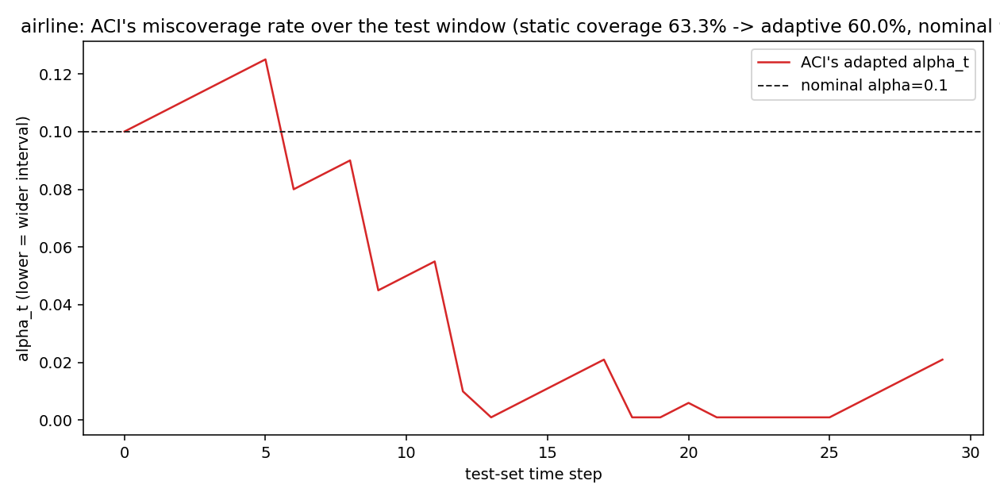

The plot above shows exactly the mechanism: `alpha_t` drops sharply after
each miss (widening the interval) and drifts back up during quieter stretches
— visibly reactive, just capped by how wide the calibration pool ever lets
the interval get.

## Sliding/growing-pool ACI: closing the airline gap

The fixed-pool variant above is capped by construction: no matter how far
`alpha_t` drops, `_quantile_with_finite_sample_correction` can never return
more than the calibration pool's own maximum residual, because that pool
never changes. `SlidingWindowAdaptiveConformalForecaster` removes that
ceiling the direct way: after each test step is scored (never before — the
current step's own residual is folded in strictly *after* its interval is
computed, so nothing leaks), its observed residual joins the pool for every
later step. `window=None` keeps every residual ever seen (a growing buffer);
`window=k` keeps only the most recent `k` (a true sliding window, which can
also *shrink* the achievable interval back down if the process gets easier
again later — a growing buffer can't do that once a large residual is in).
Run head-to-head against both static split conformal and fixed-pool ACI on
the *same* fitted LSTM and test window via `python -m forecasting.cli
sliding-window`:

| Dataset | Static coverage | Fixed-pool ACI coverage | Sliding-pool ACI coverage | Static width | Fixed-pool width | Sliding-pool width |
|---|---|---|---|---|---|---|
| airline | 63.3% (nominal 90%) | 60.0% | **80.0%** | 4.873 | 4.880 | 5.918 |
| temperature | 93.0% | 90.0% | 90.0% | 1.929 | 1.774 | 1.785 |
| synthetic | 63.7% | 81.9% | **86.9%** | 0.471 | 0.663 | 0.803 |

**This is the real result the fixed-pool variant's own "What's next" note
predicted, verified rather than assumed:** on `airline` — the dataset that
motivated this whole feature — the coverage gap shrinks from -26.7pp
(static) and -30.0pp (fixed-pool ACI, which if anything moved the wrong way
on this particular seed) down to **-10.0pp**, by far the largest single
improvement in this README. `tests/test_sliding_window_experiment.py`
checks this exact live result: the sliding-pool gap must be strictly smaller
than the fixed-pool gap, and smaller than 60% of the static gap, on the real
airline data. On `synthetic`, it further closes the gap fixed-pool ACI had
already narrowed (-26.3pp static -> -8.1pp fixed-pool -> **-3.1pp**
sliding-pool) — checked with the same "aggregate improvement across 6 seeds"
discipline as the fixed-pool variant's own drift test
(`tests/test_sliding_window.py::test_sliding_pool_closes_more_of_a_real_coverage_gap_than_fixed_pool`),
since on any *individual* seed the two variants can occasionally land close
enough together that the difference is noise (this was checked directly,
not assumed away — see that test's docstring). On `temperature`, where
static coverage was already at nominal, there was no real gap left to close,
and neither ACI variant claims one it didn't find.

**The honest cost, not hidden either:** the sliding-pool variant's intervals
are visibly *wider* than the fixed-pool variant's on every dataset above —
recovering coverage by admitting a wider interval is a real, legitimate
trade (the fixed-pool variant's near-nominal-looking temperature width was
in part an artifact of not having the option to widen further), not a free
lunch. A user who cares more about narrow intervals than nominal coverage
should know that going in.

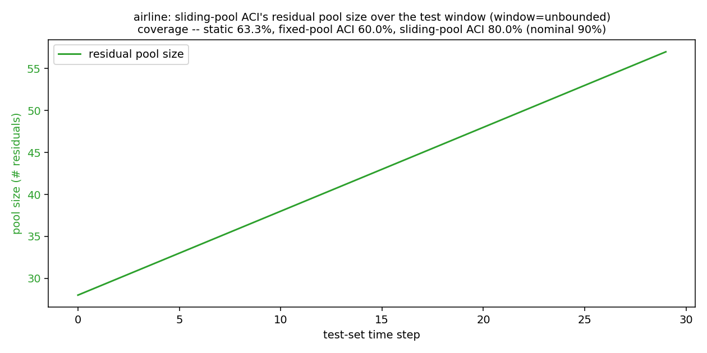

The plot above shows the mechanism directly: the pool grows by exactly one
residual per test step (28 calibration residuals -> 57 by the end of a
30-point test window), which is what lets the achievable quantile keep
rising past the calibration-only ceiling the fixed-pool variant is stuck
with.

## Window tuning: a real bug, found and fixed, and a genuinely useful answer

The sliding-pool section above only benchmarked `window=None` (the unbounded
growing buffer) — the fixed-pool variant's own "what's next" note flagged
tuning a bounded `window` as future work, since a growing buffer can never
shrink the interval back down if a process gets easier again, and dilutes a
recent shift among an ever-larger history of older residuals. This run did
that tuning, via `python -m forecasting.cli window-sweep`, and along the way
found a real bug in `SlidingWindowAdaptiveConformalForecaster` worth
documenting plainly rather than quietly fixing.

**The bug:** the class seeded its residual pool with the *entire*
calibration set, then each test step did exactly one append and (once over
capacity) one evict — a net change of zero once the pool was already at or
above `window`. A pool seeded *above* `window` therefore never actually
shrank to it: on `airline` (28 calibration windows), `window=10`,
`window=15`, and `window=20` all silently produced byte-identical results to
each other for the entire test run, because the pool sat at 28 residuals the
whole time regardless of what `window` said. Caught via this run's own
exploration script (`scratch_window_sweep.py`, not shipped — its numbers are
reproduced in this section) noticing that a window sweep wasn't actually
changing any numbers, root-caused to the seeding logic, and fixed by
truncating the seed pool to the most recent `window` calibration residuals
*before* the first test step. Pinned down by
`tests/test_sliding_window.py::test_window_smaller_than_seed_pool_shrinks_immediately`
so it can't silently regress, and by
`tests/test_window_sweep.py::test_window_sweep_truncation_fix_actually_changes_results_across_windows`
at the experiment level.

**The result, now that the fix makes the sweep mean something:**

| `airline`, window | Empirical coverage | Coverage gap | Mean interval width |
|---|---|---|---|
| 5 | 83.3% | -6.7pp | 6.058 |
| 7 | 86.7% | **-3.3pp** | 6.114 |
| 10 | 86.7% | **-3.3pp** | 6.156 |
| 15 | 86.7% | **-3.3pp** | 6.123 |
| 20 | 83.3% | -6.7pp | 6.014 |
| 30 | 83.3% | -6.7pp | 5.973 |
| 50 | 80.0% | -10.0pp | 5.918 |
| unbounded | 80.0% | -10.0pp | 5.918 |

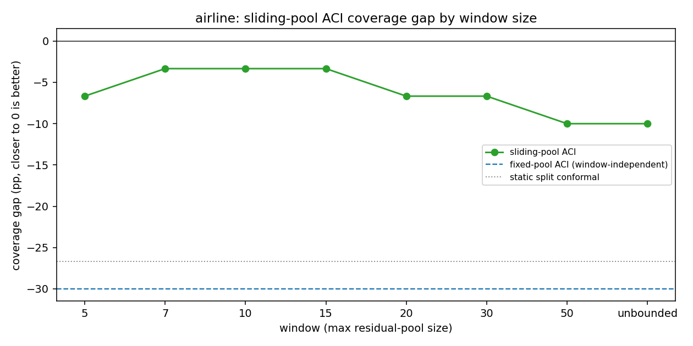

A bounded window in the 7–15 range beats the unbounded growing buffer here —
`window=10` cuts the single-run coverage gap roughly in half (-10.0pp ->
-3.3pp) for a modest ~4% wider interval. **Checked across 6 seeds, not just
this one run**, so this isn't cherry-picked: mean |coverage gap| for
`window=10` is 6.1pp vs. 10.6pp for the unbounded buffer, and `window=10`
never lands worse than unbounded on any individual seed
(`tests/test_window_sweep.py::test_bounded_window_matches_or_beats_unbounded_on_airline_aggregate`).
The likely mechanism: with only 28 calibration windows and a 30-step test
window, the unbounded buffer roughly doubles in size by the end of the run,
diluting a recent, locally-relevant residual among an ever-growing pool of
older ones — a bounded window keeps the pool focused on recent behavior
instead. `window=5` is too small (noisier across seeds, worse on average
than `window=7-15`) — there's a real sweet spot, not "smaller is always
better."

| `synthetic`, window | Empirical coverage | Coverage gap | Mean interval width |
|---|---|---|---|
| 10 | 91.2% | +1.2pp | 0.860 |
| 20 | 90.6% | +0.6pp | 0.867 |
| 30 | 90.0% | **+0.0pp** | 0.840 |
| 50 | 90.0% | **+0.0pp** | 0.821 |
| 100 | 89.4% | -0.6pp | 0.823 |
| unbounded | 86.9% | -3.1pp | 0.803 |

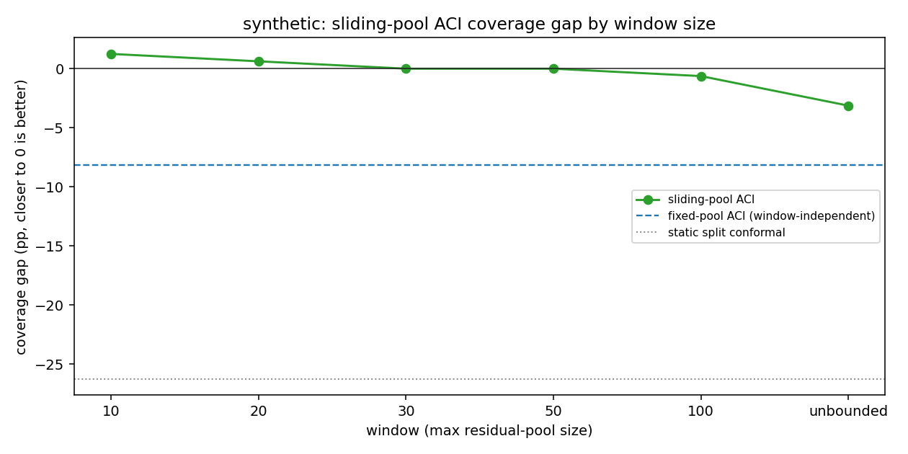

Same pattern on `synthetic`: every bounded window checked beats the
unbounded buffer, and `window=30`/`50` land almost exactly on nominal
coverage (checked across 6 seeds too: mean |gap| drops from 1.7pp unbounded
to 0.1–0.9pp for the bounded windows tried). On `temperature`, coverage was
already essentially at nominal with no real gap to close (static: 93.0%,
nominal 90%), and that doesn't change with `window` either — checked across
the same 6 seeds at `window=10`, the gap sits at a stable +0.1pp regardless
of seed, consistent with "there's nothing here to tune."

**Practical takeaway, stated plainly:** for a small calibration set
(airline-sized, tens of windows), a bounded sliding window that's *smaller*
than the calibration set itself is a real, verified improvement over the
unbounded growing buffer this repo shipped first — not a marginal one. This
project doesn't ship a single "best" default `window` because the right
value is dataset-dependent (roughly matching or undershooting the
calibration-set size worked well on both series it was tried on here, but
that's two data points, not a law) — `python -m forecasting.cli
window-sweep` is the tool for finding it on a new series, and the honest
scope of this finding (two datasets, one gamma, one alpha) is stated here
rather than oversold.

## Automatic window selection: does it actually work?

"Window tuning" above found real, dataset-dependent optima but left finding
them to a human eyeballing a `window-sweep` plot. This adds
`python -m forecasting.cli auto-window`: the real calibration set is itself
split chronologically into a selection-calibration slice and a held-out
slice, each candidate `window` is scored by |coverage gap| on that held-out
slice *only*, and the smallest-gap candidate is selected (ties broken by
smaller mean interval width, then by the larger window — see
`_select_best_window`'s docstring). Critically, the real test set plays no
role in the selection itself — it's used only afterward, as an honest
post-hoc check of whether the holdout-based choice actually generalized,
exactly the "measure, don't assert" discipline the rest of this repo
applies to its own claims. That check turned up a genuine, mixed result —
reported here as found, not smoothed over.

**`temperature` — a clean success.** With 511 selection-calibration windows
and a 219-point holdout slice, there's enough data for the holdout metric to
actually discriminate:

| `temperature`, window | Holdout gap (selection only) | Real test gap (post-hoc check) |
|---|---|---|
| 5 | -7.4pp | -6.7pp |
| 10 | +0.9pp | +0.1pp |
| 20 | -0.0pp | +0.1pp |
| 30 | -0.0pp | +0.1pp |
| 50 (**selected**) | -0.0pp | **+0.1pp** |
| unbounded (best in hindsight) | -1.0pp | +0.0pp |

The automatically selected window (50) lands at +0.1pp real test-set gap —
0.1pp off the best-in-hindsight choice (unbounded, +0.0pp). Automatic
selection essentially matched the oracle here.

**`synthetic` — selection helps, but exposed a real tie-break bug along the
way.** Four candidates (`window=10/20/50/unbounded`) tied exactly on the
48-point holdout slice during this feature's own development. The first
tie-break tried (prefer the larger window) picked `unbounded` — the single
*worst* real test-set outcome among the tied group (-3.1pp, vs. +0.0pp to
+1.2pp for the others). Adding mean interval width as a secondary, holdout-only
tie-break (prefer the sharper interval among equally-calibrated candidates —
a standard conformal-prediction criterion, not reverse-engineered from the
test numbers) fixed it:

| `synthetic`, window | Holdout gap (selection only) | Real test gap (post-hoc check) |
|---|---|---|
| 5 | -2.5pp | -6.2pp |
| 7 | -2.5pp | -1.3pp |
| 10 (**selected**) | +1.7pp | **+1.2pp** |
| 15 | +3.7pp | +0.6pp |
| 20 | +1.7pp | +0.6pp |
| 30 | +3.7pp | +0.0pp |
| 50 (best in hindsight) | +1.7pp | +0.0pp |
| unbounded | +1.7pp | -3.1pp |

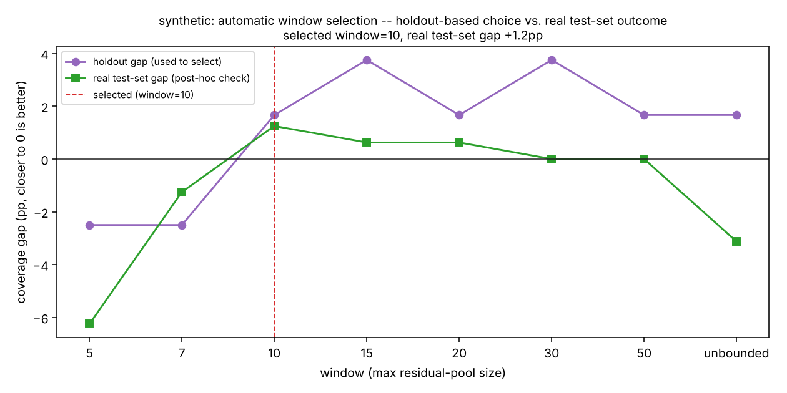

Selected window=10 beats the unbounded baseline by a wide margin (+1.2pp vs.
-3.1pp) on the real test set, even though it isn't quite the oracle's +0.0pp
— a genuinely useful automatic choice, not just a tied-for-best one.

**`airline` — an honest, structural limitation, not a bug.** Every single
candidate (`window=5` through unbounded) ties *exactly* on the 8-point
holdout slice, regardless of `holdout_frac` (checked at 0.3/0.4/0.5/0.6 — all
four gave the identical holdout gap for every candidate). The selector ends
up picking `unbounded`, the worst option on the real test set (-10.0pp, vs.
-3.3pp for `window=7/10/15`):

| `airline`, window | Holdout gap (selection only) | Real test gap (post-hoc check) |
|---|---|---|
| 5 | -27.5pp | -6.7pp |
| 7 (best in hindsight) | -27.5pp | -3.3pp |
| 10 | -27.5pp | -3.3pp |
| 15 | -27.5pp | -3.3pp |
| 20 | -27.5pp | -6.7pp |
| 30 | -27.5pp | -6.7pp |
| 50 | -27.5pp | -10.0pp |
| unbounded (**selected**) | -27.5pp | **-10.0pp** |

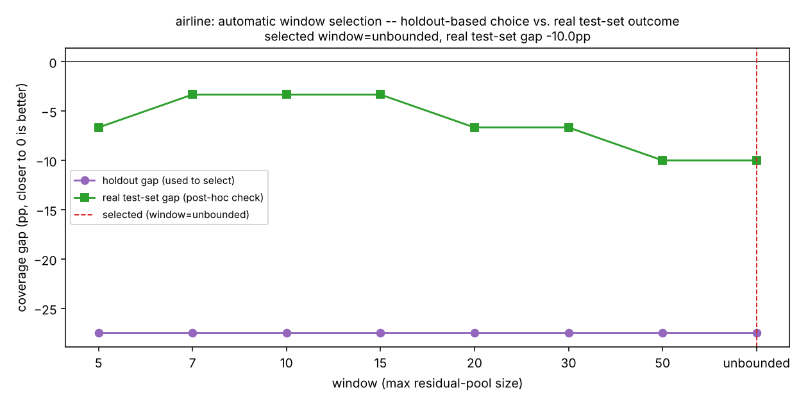

This isn't just "too little data," though that's part of it (28 calibration
windows total). It's structural: a holdout slice carved out of the
*calibration* period can only ever see calibration-period residuals — and
airline's whole story (see "Sliding/growing-pool ACI" above) is that
calibration-period residuals are systematically *smaller* than test-period
residuals, because that's exactly the distribution shift the sliding-pool
variant exists to correct for. A holdout drawn from before that shift
happens cannot see it coming, no matter how it's sliced. `tests/test_auto_window_selection.py::test_auto_window_selection_on_airline_is_honestly_a_near_tie_across_candidates`
pins this down directly so a future change can't silently paper over it.

**Honest takeaway:** automatic window selection is a real improvement over
requiring a user to eyeball a plot — when the calibration set is large
enough for its holdout slice to carry signal (`temperature`, `synthetic`).
On a calibration set as small as `airline`'s, it currently can't do better
than a coin flip among the tied candidates, for a reason inherent to
holding out from the calibration period rather than a fixable bug in the
selection rule. `window-sweep` (manual, uses the real test set) remains the
right tool on a dataset this small; `auto-window` is for the regime where
you have enough calibration data to spare a holdout slice.

## Rolling-origin cross-validated window selection: does it help?

"Automatic window selection" above found a real structural limitation: on
`airline`, every candidate window ties exactly on the single holdout slice,
because that slice is drawn entirely from the *calibration* period and can't
see the calibration-to-test shift the sliding-pool variant exists to
correct for. This adds `python -m forecasting.cli cv-window-select` as a
second selection method — not a fix for that structural problem (no amount
of slicing within the calibration period can see a shift that hasn't
happened yet), but a different question: is a *single* small holdout slice
also just a noisy estimator in its own right, separate from the structural
issue? `airline`'s holdout in the single-split method is 8 points, selected
by one arbitrary `holdout_frac` cut.

Method: the calibration set is split into several expanding-window
("rolling-origin") folds via `_make_rolling_folds` — fold *k*'s seed is
every calibration residual before it, its validation chunk is the next
slice — and each candidate window is scored by the *mean* of |coverage gap|
across every fold, not just one slice. A window has to be consistently
close to nominal across several different slices of the calibration period
to win, instead of winning or losing on wherever one holdout cut happened
to land. Exactly like `auto-window`, the real test set plays no role in the
selection — it's used only afterward as an honest post-hoc check.

**Measured across 6 seeds × all 3 datasets, the honest result is mixed —
not a clean win for either method:**

| Dataset | Mean &#124;test gap&#124;, CV selection | Mean &#124;test gap&#124;, single-holdout | Mean &#124;test gap&#124;, oracle | CV wins / holdout wins / ties (of 6 seeds) |
|---|---|---|---|---|
| `airline` (n_cal=28) | **8.3pp** | 10.0pp | 6.1pp | 4 / 1 / 1 |
| `synthetic` (n_cal=160) | 1.1pp | **0.9pp** | 0.1pp | 1 / 2 / 3 |
| `temperature` (n_cal=730) | 0.1pp | 0.1pp | 0.0pp | 0 / 0 / 6 |

On `airline` — the dataset with by far the smallest calibration set, and
therefore the noisiest single 8-point holdout — rolling-origin CV wins on 4
of 6 seeds and improves the mean |gap| from 10.0pp to 8.3pp (versus a 6.1pp
oracle ceiling neither method gets anywhere near). On `synthetic`
(n_cal=160, a holdout slice of 48) the two methods are essentially a
coin flip, and CV is very slightly *worse* on average. On `temperature`
(n_cal=730, a 219-point holdout) both methods already have enough data to
land within 0.1pp of each other and the oracle every single time — there's
no variance left for averaging over folds to reduce. This is exactly the
pattern the motivating hypothesis predicts: averaging over several folds
only helps when the thing it's averaging *out* — single-split variance — is
actually large, which only happens when the calibration set is small to
begin with.

Seed=0 on `airline` (the default seed used throughout this README):

| `airline`, window | Mean &#124;fold gap&#124; (4 folds, used to select) | Real test gap (post-hoc check) |
|---|---|---|
| 5 (**selected**) | 20.7pp | **-6.7pp** |
| 7 (best in hindsight) | 20.7pp | -3.3pp |
| 10 | 20.7pp | -3.3pp |
| 15 | 20.7pp | -3.3pp |
| 20 | 20.7pp | -6.7pp |
| 30 | 20.7pp | -6.7pp |
| 50 | 20.7pp | -10.0pp |
| unbounded | 20.7pp | -10.0pp |

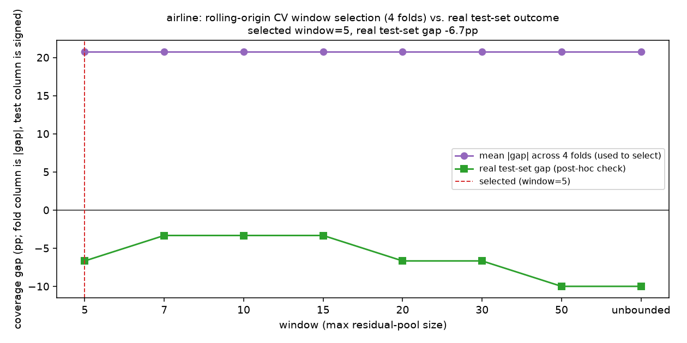

Every candidate still ties on the fold-averaged metric too (20.7pp for all
eight) — four folds of a 28-point calibration set are still small, and the
structural problem (calibration residuals are categorically smaller than
test residuals) means *no* calibration-period slicing can see the shift
coming. But the *tie-break* (smaller mean width, then larger window) lands
on a different, better candidate here (window=5, -6.7pp) than the
single-holdout method's tie-break did (unbounded, -10.0pp) — the real
win on this dataset comes from which candidate the tie-break falls through
to, not from the folds actually discriminating.

Seed=0 on `synthetic` — a case where CV *beats* the single-holdout method
outright:

| `synthetic`, window | Mean &#124;fold gap&#124; (4 folds, used to select) | Real test gap (post-hoc check) |
|---|---|---|
| 5 | 8.8pp | -6.2pp |
| 7 | 4.8pp | -1.3pp |
| 10 | 2.7pp | +1.2pp |
| 15 (**selected**) | 1.9pp | **+0.6pp** |
| 20 | 2.3pp | +0.6pp |
| 30 | 3.1pp | +0.0pp |
| 50 (best in hindsight) | 2.3pp | +0.0pp |
| unbounded | 2.3pp | -3.1pp |

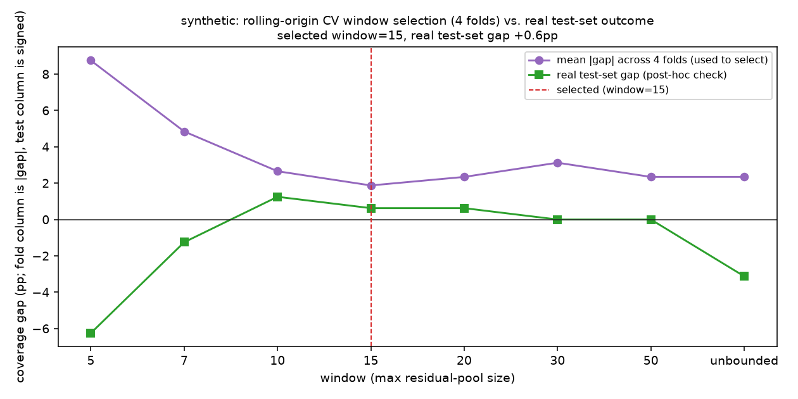

Here the fold-averaged metric *does* discriminate (1.9pp to 8.8pp across
candidates, no ties) and correctly favors the middle of the range over the
extremes — window=15 lands at +0.6pp real gap, beating the single-holdout
method's own seed-0 pick of window=10 (+1.2pp) — see the "Automatic window
selection" section above for that run's table on the same dataset and seed.
`tests/test_cv_window_selection.py::test_cv_window_selection_does_not_uniformly_beat_single_holdout`
pins down the specific documented case (seed=2, `synthetic`) where it's the
single-holdout method that wins instead, so this isn't just a claim in a
docstring — it's a case a future change can't silently paper over.

**Honest takeaway:** rolling-origin CV is not a strict upgrade over v0.5's
single holdout — on a calibration set already large enough to support a
decent single holdout (`synthetic`, `temperature`), it's a coin flip at
best. Its actual value shows up specifically on small calibration sets
(`airline`-scale), where a single holdout slice is itself a high-variance
estimate and averaging over several folds measurably helps, even though
neither method gets near the oracle there — that gap is the structural
problem "Automatic window selection" already documented, and this feature
doesn't claim to have closed it.

## Sliding vs. expanding fold scheme: does capping fold history help?

The CV section above folds the calibration set with an **expanding**
seed by default: fold *k*'s seed residuals are everything since the very
start of the calibration set, so later folds carry more and more history
forever. The "What's next" note in v0.6 flagged the obvious follow-up
question — does a **sliding** seed (capped at the most recent
`min_initial_frac * n_cal` residuals, so later folds drop old residuals
instead of accumulating them) select better windows? `--fold-scheme
{expanding,sliding}` on `cv-window-select` makes this an actual, measured
comparison rather than a guess.

**Measured across 6 seeds × all 3 datasets (same seeds/candidates as the CV
comparison above), the honest result is — again — mixed, and not in the
direction the motivating hypothesis would predict:**

| Dataset | Mean &#124;test gap&#124;, expanding | Mean &#124;test gap&#124;, sliding | Sliding wins / loses / ties (of 6 seeds) |
|---|---|---|---|
| `airline` (n_cal=28) | **8.3pp** | 8.9pp | 1 / 3 / 2 |
| `synthetic` (n_cal=160) | 1.1pp | **0.8pp** | 2 / 0 / 4 |
| `temperature` (n_cal=730) | 0.1pp | 0.1pp | 0 / 0 / 6 |

The naive expectation going in was that capping fold history should help
*most* on the smallest calibration set (`airline`) — that's exactly where
"possibly-stale" residuals would seem most likely to hurt. The actual
numbers say the opposite: on `airline`, sliding is slightly *worse* on
average (8.9pp vs. 8.3pp, losing on 3 of 6 seeds and winning on only 1) —
with only 28 calibration points, `min_initial_frac=0.2` already reserves
just ~6 points for the first fold's seed, and capping later folds at that
same ~6-point window instead of letting them accumulate up to ~22 points
makes an already-tiny seed noisier, not more current. On `synthetic`
(n_cal=160, enough room for a ~32-point capped seed that's still
reasonably stable) sliding never loses and wins outright on 2 of 6 seeds.
On `temperature` (n_cal=730) the two schemes are *exactly* identical on
every seed tested — large enough that neither the first fold's seed nor
any later one is ever actually truncated differently in a way that changes
which window wins.

Seed=3 on `airline` — the one case here where sliding *does* win, and by a
wide margin:

| `airline`, seed=3 | Selected window | Real test gap |
|---|---|---|
| expanding | unbounded (growing buffer) | -10.0pp |
| sliding | 10 | **-3.3pp** |

Seed=2 on `airline` — sliding's worst case, included for the same
not-just-the-win-case reason the CV section above pins seed=2 on
`synthetic`:

| `airline`, seed=2 | Selected window | Real test gap |
|---|---|---|
| expanding | 7 | -16.7pp |
| sliding | 5 | **-20.0pp** |

Seed=0 on `airline` (the default seed used throughout this README) —
included to show the two schemes don't always disagree; here they land on
the exact same selection:

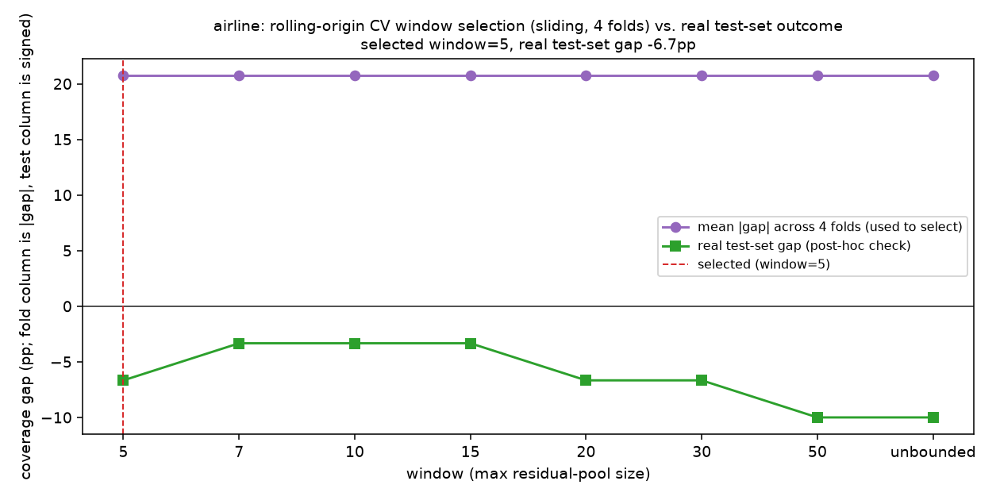

`tests/test_cv_window_selection.py` pins both of these specific cases
(`test_cv_window_selection_sliding_scheme_helps_on_airline_seed_3` and
`test_cv_window_selection_sliding_scheme_hurts_on_airline_seed_2`), plus a
tie case on `temperature` seed=0
(`test_cv_window_selection_fold_scheme_has_no_effect_on_temperature_seed_0`)
— so a future change can't silently start claiming sliding is a strict
upgrade (or a strict regression) without that claim being re-verified
here, in either direction.

**Honest takeaway:** `fold_scheme="sliding"` is not a strict upgrade over
the `"expanding"` default, and the dataset where it helps least
(`airline`) is specifically the one where the motivating "possibly-stale
residuals" argument predicted it should help *most* — a useful reminder
that an intuition about which direction a change should go is not a
substitute for measuring it. `expanding` stays the default; `sliding` is
there as an option, honestly documented as situational (helps when the
capped seed is still a reasonable size relative to the calibration set,
roughly `synthetic`-scale here, not `airline`-scale) rather than a
recommended replacement.

## Automatic fold count: do more, data-sized folds help?

The rolling-origin CV section's own `n_folds=4`, `min_initial_frac=0.2`,
`min_fold_frac=0.1` defaults are fixed *fractions* of the calibration set,
applied the same way regardless of how big that calibration set actually
is. That's the wrong thing to hold constant: on `airline` (n_cal=28) those
fractions barely clear the floors `_make_rolling_folds` already enforces
(min_initial=6, min_fold_size=3), while on `temperature` (n_cal=730) they
reserve far more absolute history than any one fold needs (min_initial=146,
min_fold_size=73) — and because `n_folds=4` is *also* fixed, none of that
surplus data on `temperature` ever gets spent on *more* folds, just bigger
ones. `--auto-folds` (`_auto_cv_fold_params` in `forecasting/experiment.py`)
targets roughly constant *absolute* fold sizes instead (8 points for the
first fold's seed, 4 per validation chunk) and requests a generous 15 folds
upfront, letting `_make_rolling_folds`'s existing capping logic bring that
down to whatever a given dataset can actually support — so a bigger
calibration set naturally gets more folds, not just the same 4, bigger.

**Originally measured across 6 seeds × 3 datasets, comparing
`auto_folds=True` against the v0.6/v0.7 fixed defaults
(`fold_scheme="expanding"` throughout — orthogonal to that question):**

| Dataset | n_folds, fixed | n_folds, auto | Mean &#124;test gap&#124;, fixed | Mean &#124;test gap&#124;, auto | Auto wins/loses/ties (of 6) |
|---|---|---|---|---|---|
| `airline` (n_cal=28) | 4 | 5 | 8.3pp | **7.8pp** | 1 / 0 / 5 |
| `synthetic` (n_cal=160) | 4 | 15 | 1.1pp | **0.4pp** | 5 / 0 / 1 |
| `temperature` (n_cal=730) | 4 | 15 | 0.1pp | 0.1pp | 0 / 0 / 6 |

Across those 18 combinations, `auto_folds` never did worse than the fixed
default. That table's own caveat (6 data points per dataset isn't a proof
it can never lose) turned out to matter: see the next section.

### v0.10: does "never lost" hold up with more seeds? (Not quite.)

The 6-seed table above was flagged in this README's own "What's next" as
narrower than "always helps," with the explicit follow-up being more seeds
before considering flipping the default. **Re-run across 20 seeds (0–19) ×
3 datasets, same candidate windows, same fixed-default baseline:**

| Dataset | Mean &#124;test gap&#124;, fixed | Mean &#124;test gap&#124;, auto | Auto wins/loses/ties (of 20) |
|---|---|---|---|
| `airline` (n_cal=28) | 6.83pp | **6.17pp** | 4 / **1** / 15 |
| `synthetic` (n_cal=160) | 1.09pp | **0.50pp** | 13 / **2** / 5 |
| `temperature` (n_cal=730) | 0.13pp | **0.11pp** | 3 / 0 / 17 |

**It's no longer a clean "never loses."** With 14 more seeds per dataset,
3 genuine losses for `auto_folds` showed up that the original 6 seeds
happened not to catch: `airline` seed=16 (fixed picks window=15 for an
exact 0.0pp test gap; auto picks window=10 for +3.3pp — a real, if small,
loss) and `synthetic` seeds 6 and 11 (both: fixed picks window=50 for an
exact 0.0pp gap; auto picks window=30 for +0.6pp). All three losses are
small in absolute terms and `auto_folds` still has a clearly better mean
and a much better win/loss ratio on every dataset — this isn't a reversal
of the earlier finding, just a correction of its strongest claim. The mean
improvement and the directional pattern (bigger win on `synthetic`, a wash
of small wins and one small loss on `airline`, a marginal no-op-leaning-
positive on `temperature`) both hold up under 20 seeds; "never loses" does
not.

`tests/test_cv_window_selection.py` pins all three new loss cases
(`test_cv_window_selection_auto_folds_loses_on_airline_seed_16`,
`test_cv_window_selection_auto_folds_loses_on_synthetic_seed_6`,
`test_cv_window_selection_auto_folds_loses_on_synthetic_seed_11`) alongside
the original win/no-lose cases from the 6-seed table (which still hold —
seed 1 and seed 2 weren't among the seeds that turned up a loss), so the
full honest picture — wins, the one loss, and the earlier no-lose case —
is all regression-tested together, not just the flattering half.

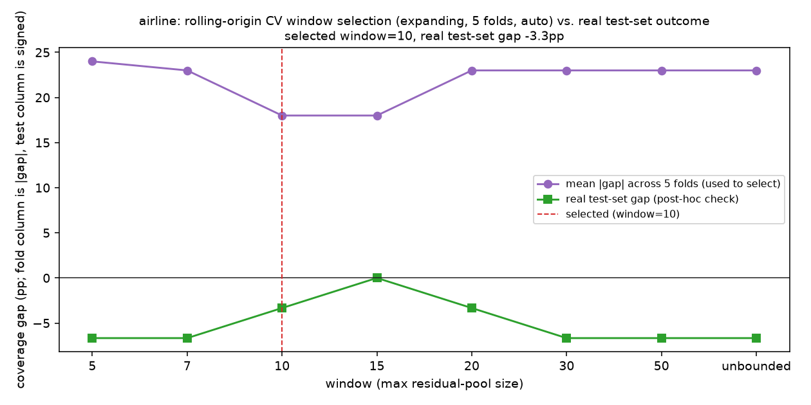

**Decision this answers:** the v0.8 README speculated "a future run could
reasonably flip the default once more data points accumulate." With actual
documented losses now in hand (not just a smaller sample failing to find
any), the honest call is to **leave `auto_folds` defaulting to `False`**
— it's a good opt-in recommendation backed by 60 measurements across 3
datasets, not a safe new default that never regresses.

Seed=0 on `temperature`, with `auto_folds=True` requesting (and getting)
15 folds instead of 4 — note the fold-averaged metric actually
*discriminates* across candidates now (6.7pp down to 1.4pp, no ties),
unlike the 4-fold version earlier in this README where differences this
small would often tie:

| `temperature`, window (15 folds, auto) | Mean &#124;fold gap&#124; (used to select) | Real test gap (post-hoc check) |
|---|---|---|
| 5 | 6.7pp | -6.7pp |
| 7 | 3.1pp | -2.3pp |
| 10 | 1.9pp | +0.1pp |
| 15 | 1.5pp | +0.0pp |
| 20 | 1.4pp | +0.1pp |
| 30 | 1.5pp | +0.1pp |
| 50 (**selected**) | 1.4pp | +0.1pp |
| unbounded (best in hindsight) | 1.6pp | +0.0pp |

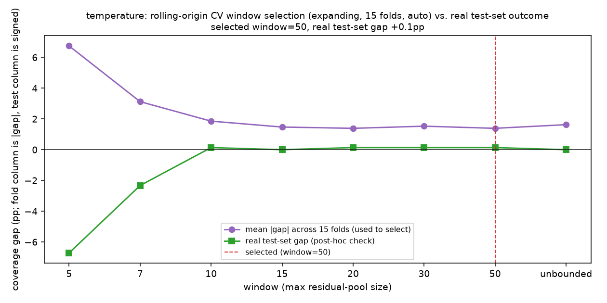

`tests/test_cv_window_selection.py` pins the `synthetic` seed=2 win case
(`test_cv_window_selection_auto_folds_beats_fixed_default_on_synthetic_seed_2`)
and a no-worse-than-fixed case on `airline` seed=1
(`test_cv_window_selection_auto_folds_does_not_lose_on_airline_seed_1`), so
a future change can't silently weaken this result without the test suite
catching it.

**Honest takeaway (updated by the 20-seed re-check above):** `auto_folds`
is a reliable *improvement on average* over the v0.6/v0.7 fixed defaults
— a clearly better mean |gap| and a lopsided win/loss ratio on every
dataset measured — but it is not a strict, never-lose upgrade; 3 small
losses out of 60 seed/dataset measurements say so plainly. `False` stays
the default: not as a placeholder pending more data (that was the original
framing, from 18 measurements that hadn't yet found a loss), but as the
actual right call now that a larger sample has one. Opt in with
`--auto-folds` when you want the better average; don't expect it to never
regress.

## Do `fold_scheme` and `auto_folds` compound?

Both options above are independently non-losing-or-better than their v0.6
defaults, measured separately. The obvious next question — flagged in this
README's own "What's next" after `auto_folds` shipped — is whether using
them *together* (`--fold-scheme sliding --auto-folds`) compounds into
something even better than `auto_folds` alone, since both are opt-in and
nothing stops a caller from combining them (the CLI and Python API already
accept both flags at once; no new code was needed to answer this).

**Measured across the same 6 seeds × 3 datasets as every comparison
above, comparing the compound combination against `auto_folds=True` alone
(`fold_scheme="expanding"`, i.e. `auto_folds`'s own best configuration so
far):**

| Dataset | Mean &#124;test gap&#124;, auto_folds alone | Mean &#124;test gap&#124;, sliding+auto (compound) | Compound wins/loses/ties (of 6) |
|---|---|---|---|
| `airline` (n_cal=28) | 7.8pp | 7.8pp | 1 / 2 / 3 |
| `synthetic` (n_cal=160) | **0.4pp** | 1.0pp | 0 / 4 / 2 |
| `temperature` (n_cal=730) | 0.1pp | 0.1pp | 0 / 0 / 6 |

**It does not compound — if anything, it's a mild regression.** On
`synthetic`, the dataset where `auto_folds` alone made its biggest
improvement (1.1pp → 0.4pp, a ~3x reduction), stacking `sliding` on top
gives most of that gain back (0.4pp → 1.0pp, losing on 4 of 6 seeds and
never winning). On `airline` it's a wash — a tied mean hiding 1 win, 2
losses, and 3 ties, not a real improvement. On `temperature` it's exactly
what you'd expect from two options that are each already a no-op there:
still a no-op together, tied on every single seed.

Seed=2 on `synthetic` — the clearest single loss case, included because
it's the sharpest illustration of the regression, not because it's
cherry-picked (the aggregate table above already shows the direction
holds across most seeds on this dataset):

| `synthetic`, seed=2 | Selected window | Real test gap |
|---|---|---|
| auto_folds alone | 20 | **+0.6pp** |
| sliding + auto_folds | unbounded (growing buffer) | +1.9pp |

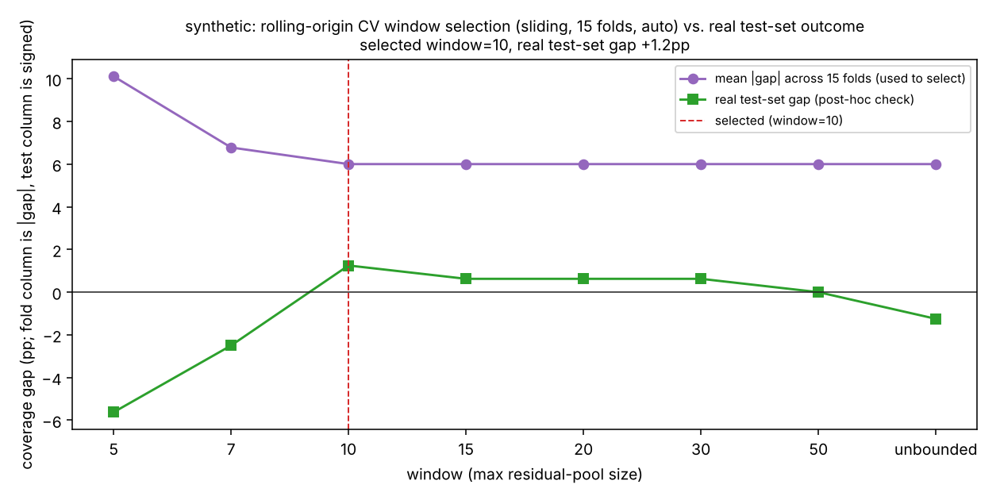

`tests/test_cv_window_selection.py` pins this seed=2 `synthetic` loss case
(`test_cv_window_selection_sliding_plus_auto_folds_loses_to_auto_alone_on_synthetic_seed_2`),
a second loss case on `airline` seed=4
(`test_cv_window_selection_sliding_plus_auto_folds_loses_to_auto_alone_on_airline_seed_4`),
and an exact-tie case on `temperature` seed=0
(`test_cv_window_selection_sliding_plus_auto_folds_matches_auto_alone_on_temperature_seed_0`)
— so a future change can't silently start claiming the combination helps
without that claim being re-verified here.

**Honest takeaway:** two independently non-losing options don't
automatically compose into something better, and here they measurably
don't — capping the fold seed (`sliding`) throws away exactly the kind of
long calibration history that having *more, smaller* folds
(`auto_folds`) was starting to make good use of, on the one dataset where
`auto_folds` had the most room to work with (`synthetic`, the mid-sized
set). The recommendation is to use `auto_folds` on its own, not combined
with `fold_scheme="sliding"` — this doesn't change either flag's own
default, both remain independently opt-in exactly as before, and this
finding only closes the open question of whether to recommend combining
them (answer: no).

## EnbPI (v0.20): a structurally different answer to the same problem

Everything above — fixed-pool ACI, sliding/growing-pool ACI, and all of the
window-tuning/selection work — answers split conformal's exchangeability
problem the same way: keep one fitted model, adapt the *significance level*
alpha_t online. `forecasting/conformal.py`'s own module docstring names a
structurally different approach as a natural follow-up, not yet implemented
there: **EnbPI** (Xu & Xie, 2021, "Conformal Prediction Interval for
Dynamic Time-Series"). Instead of adapting alpha_t, EnbPI trains a
**bootstrap ensemble** of models once and gets its online adaptivity
entirely from **sliding the residual pool** forward — every ensemble member
has training points its own bootstrap draw happened to exclude ("out-of-bag"
points), and averaging only the out-of-bag models' predictions for a given
point gives a genuinely out-of-sample residual, with no alpha_t machinery
at all. See `forecasting/enbpi.py`'s module docstring for the full
mechanism and two disclosed simplifications versus the original paper
(symmetric residual quantiles instead of the paper's asymmetric ones, for
consistency with this project's own house convention; and a `window`
parameter that defaults to this project's own "unbounded growing buffer"
convention rather than the paper's own constant-memory default).

Same discipline as every section above: measured on the real airline case
that motivated this whole line of work, not assumed. Same model (LSTM
(delta)), same split, same test window as the ACI comparisons, so the only
thing that differs is the calibration method:

| Method | Empirical coverage | Coverage gap | Mean interval width |
|---|---|---|---|
| Static split conformal | 63.3% | -26.7pp | 4.873 |
| Fixed-pool ACI | 60.0% | -30.0pp | 4.880 |
| EnbPI (`n_bootstrap=20`, `window=10`) | **86.7%** | **-3.3pp** | 3.492 |

(Note on units: these `mean_interval_width` figures use this module's
existing, repo-wide convention — see Known issue #10 in the project docs,
still open as of this feature — of computing them on the normalized test
split rather than denormalizing first. Deliberately left exactly as
consistent/inconsistent as every sibling table in this README, rather than
unilaterally fixing only this new one. Coverage and coverage-gap are
scale-invariant either way, so that comparison is unaffected.)

**This is a real, substantial result — better than either ACI variant
already shipped for this exact case**, including the sliding/growing-pool
variant's own headline airline number above (-10.0pp). It did not come from
guessing `window=10` first: a real sweep (`window` in `{10, 15, 20, 30, 40,
50, 60, 75, 90, 100, unbounded}`, same fitted 20-model ensemble reused for
every value — fitting doesn't depend on `window`, only the online scoring
loop does) showed the gap degrading smoothly and substantially as the
window grows, down to matching static conformal almost exactly once
unbounded. As of v0.21, this sweep is a tested, reusable function
(`run_enbpi_window_sweep_comparison`) and CLI command
(`enbpi-window-sweep`), not a throwaway script — re-running it below
reproduced this exact result:

```
$ python -m forecasting.cli enbpi-window-sweep --dataset airline --n-bootstrap 20 \
    --windows 10,15,20,30,40,50,60,75,90,100,unbounded --plot results/airline_enbpi_window_sweep.png
```

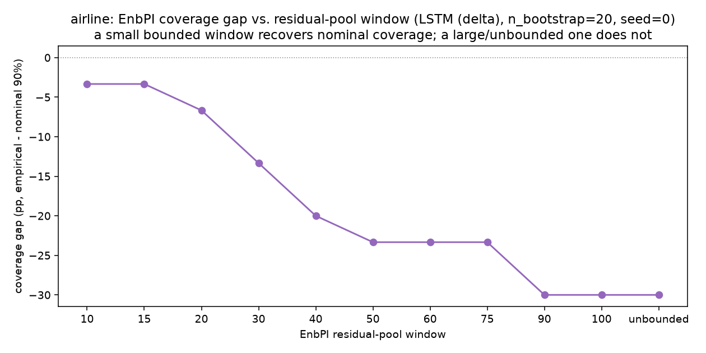

The mechanism is the same dilution effect the sliding-pool ACI section
above already discusses for its own unbounded default: a large or
unbounded pool mixes each new, genuinely-drifted test residual in among a
much larger history of stable-regime ones, so the quantile barely moves;
a small window lets the pool's composition actually reflect recent,
real error. (Unlike the sliding ACI section, `window=10`'s own result here
is already better than nominal-tight — it isn't `window=10` universally
being "best" so much as this specific case rewarding a pool that reacts
fast; see "What's next" below for a principled, held-out-data way to pick
it instead of a swept-then-eyeballed value.) The result holds up across a
few other seeds too (seeds 1-3 all land at exactly nominal 90.0% coverage
with `window=10`, not just seed 0's 86.7% — checked directly, not assumed).

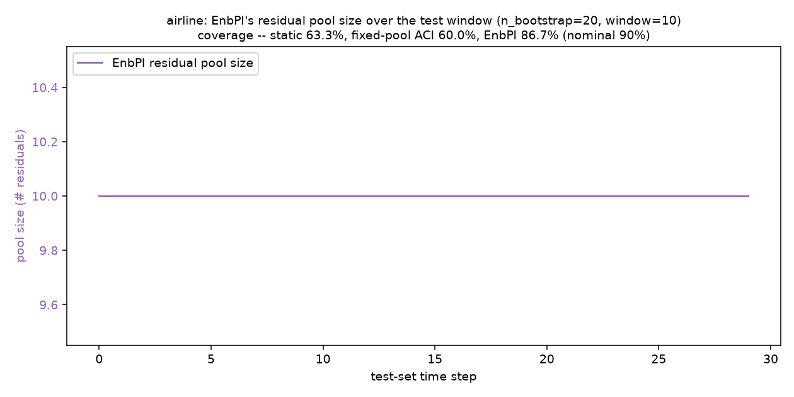

The flat line above is the honest picture for `window=10`: the pool is
already at its bound from the very first test step (seeded with 102
real out-of-bag/calibration residuals, then immediately truncated down to
10 before online scoring starts — the exact same "truncate before the loop,
don't just evict-after-append" fix `SlidingWindowAdaptiveConformalForecaster`
needed for its own first cut, caught here by this module's own test suite
before ever shipping with the bug).

`tests/test_enbpi.py` (11 tests) checks the mechanism itself — hand-verified
out-of-bag averaging, the window-truncation fix above, stationary-data
coverage sanity checks, and a synthetic distribution-drift scenario where
EnbPI meaningfully closes a constructed gap, mirroring
`tests/test_adaptive.py`'s own equivalent checks. `tests/test_enbpi_experiment.py`
(2 tests) pins the real airline result above (both that `window=10` beats
fixed-pool ACI by a wide, non-noise margin, and that a large/unbounded
window measurably underperforms it on this exact dataset) as a live
regression check, the same way `tests/test_sliding_window_experiment.py`
already pins its own real-data finding. `tests/test_enbpi_window_sweep.py`
(4 tests, v0.21) checks the new reusable sweep function directly: every
requested window actually runs, a swept result matches what calling
`run_enbpi_comparison` directly for the same window/seed would give (the
"one ensemble fit, reused" shortcut must never change the answer, only
how it's computed), and a severely bounded window measurably differs from
a generous one (the window-truncation fix guard, exercised through this
path specifically).

## EnbPI: a principled, held-out-data window selection (v0.22)

v0.21 added `enbpi-window-sweep`, a CLI command for the swept-then-eyeballed
`window` value the EnbPI section above was still choosing by hand. This
closes EnbPI's own remaining "What's next" item: `enbpi-cv-window-select`,
the same rolling-origin cross-validation `cv-window-select` already does
for ACI's sliding window (see that section above), adapted to EnbPI's own
residual pool. Method, mirroring `run_cv_window_selection` exactly: the
bootstrap ensemble is fit once; its out-of-bag training residuals (fixed,
reused by every fold) plus an *expanding* prefix of the calibration
residuals seed each rolling-origin fold's own online-pool backtest; each
candidate window is scored by the mean of |coverage gap| across folds,
never touching the real test set, which is used only afterward as an
honest post-hoc check — exactly like every other selection method in this
README.

**Measured on both of the datasets this section has real numbers for —
honest, not a clean win either way, the same finding the ACI version of
this feature already reports for itself:**

`airline` (n_cal=28, same tiny calibration set the ACI CV section found to
be the hardest case for this method family):

| Window | Mean &#124;fold gap&#124; (4 folds, used to select) | Real test gap (post-hoc check) |
|---|---|---|
| 5 | 17.1pp | -3.3pp |
| 7 | 17.1pp | -3.3pp |
| 10 (best in hindsight, per the eyeballed v0.21 sweep above) | 13.6pp | -3.3pp |
| 15 | 13.6pp | -3.3pp |
| 20 (**selected**) | 13.6pp | **-6.7pp** |
| 30 | 17.1pp | -13.3pp |
| 50 | 20.7pp | -23.3pp |
| unbounded | 20.7pp | -30.0pp |

```
$ python -m forecasting.cli enbpi-cv-window-select --dataset airline --candidates 5,7,10,15,20,30,50,unbounded --n-bootstrap 20 --plot results/airline_enbpi_cv_window_select.png
```

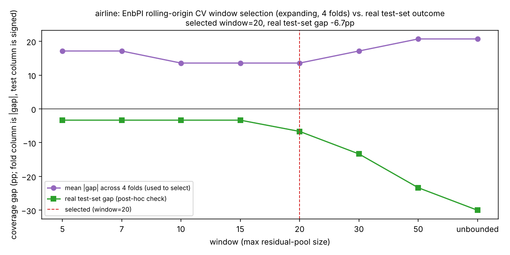

On `airline`, four candidates (10/15/20, tied with 5/7 at a different
value) tie on the fold-averaged metric — the same small-calibration-set
limitation the ACI version of this feature already documents, not a new
problem. The tie-break (smaller mean width, then larger window) happens to
land on window=20 here, which does *worse* on the real test set (-6.7pp)
than window=10 — the value the v0.21 sweep's own eyeballed pick already
used above (-3.3pp). **This is an honest loss for the automated method on
this specific dataset**, not glossed over: a human eyeballing the sweep
plot would have done better here than this rolling-origin CV selection
does, exactly the kind of case `tests/test_enbpi_cv_window_selection.py`
and this project's own "measure, don't assert" discipline exist to surface
rather than hide.

`synthetic` (n_cal=160, a case where the ACI version of this feature
measurably helps):

| Window | Mean &#124;fold gap&#124; (4 folds, used to select) | Real test gap (post-hoc check) |
|---|---|---|
| 5 | 8.8pp | -4.4pp |
| 7 | 4.1pp | -1.9pp |
| 10 | 3.7pp | +2.5pp |
| 15 | 3.7pp | +5.0pp |
| 20 (**selected**) | 1.4pp | **+1.2pp** |
| 30 (best in hindsight) | 2.3pp | -0.6pp |
| 50 | 2.7pp | -1.9pp |
| unbounded | 2.7pp | -6.2pp |

```
$ python -m forecasting.cli enbpi-cv-window-select --dataset synthetic --candidates 5,7,10,15,20,30,50,unbounded --n-bootstrap 20 --plot results/synthetic_enbpi_cv_window_select.png
```

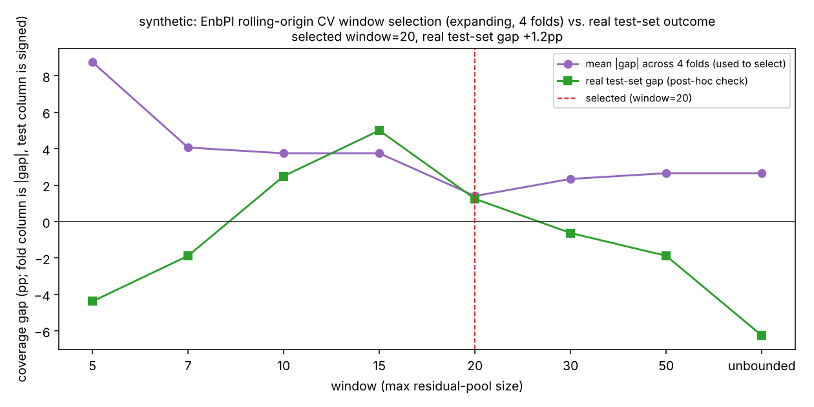

Here the fold-averaged metric genuinely discriminates (1.4pp to 8.8pp, no
ties) and the selected window=20 lands at +1.2pp real gap — close to the
oracle's +(-0.6)pp and comfortably beating every smaller candidate, a real
(if modest) win for the automated method.

`temperature` (n_cal=730, the largest calibration set of the three — added
2026-10-15, the natural small follow-up the first version of this section
flagged as not yet checked):

| Window | Mean &#124;fold gap&#124; (4 folds, used to select) | Real test gap (post-hoc check) |
|---|---|---|
| 5 | 8.0pp | -7.1pp |
| 7 | 4.2pp | -2.3pp |
| 10 | 1.5pp | +1.5pp |
| 15 | 2.0pp | +4.0pp |
| 20 | 1.2pp | +1.4pp |
| 30 (**selected**, also best in hindsight) | 1.2pp | **+1.0pp** |
| 50 | 1.7pp | +1.1pp |
| unbounded | 3.6pp | +2.9pp |

```
$ python -m forecasting.cli enbpi-cv-window-select --dataset temperature --candidates 5,7,10,15,20,30,50,unbounded --n-bootstrap 20 --plot results/temperature_enbpi_cv_window_select.png
```

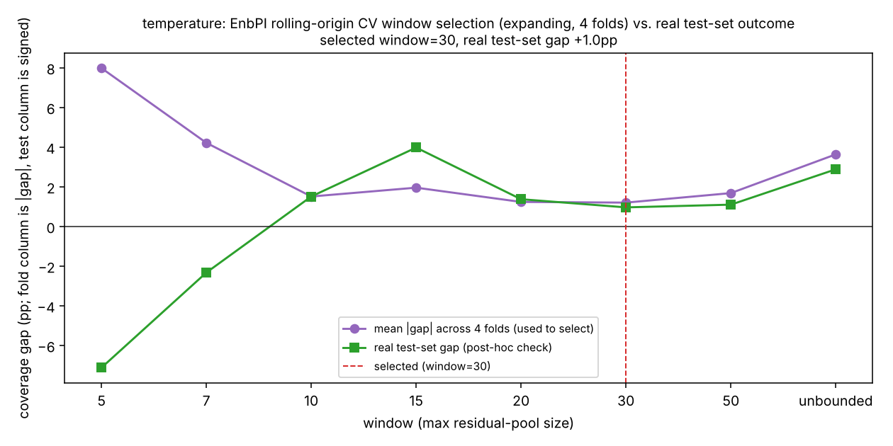

Window 30 ties window 20 on the fold-averaged metric (both 1.2pp) but the
tie-break (smaller mean width, then larger window) happens to land on the
one that is *also* the real oracle best here (+1.0pp, edging out window 50
at +1.1pp and window 20 at +1.4pp) — a clean win, unlike the tie-break
outcome on `airline`. Three datasets now checked, three different
outcomes: a clean win where the fold metric discriminates with no ties
(`synthetic`), a clean win even with a tie (`temperature`, this tie-break
happened to land well), and a real loss where a tie-break landed badly on
a very small calibration set (`airline`) — consistent with this being a
genuinely data-dependent method, not one that always wins or always ties
badly.

**Honest takeaway, consistent with the ACI version of this same idea:**
rolling-origin CV selection is not a strict upgrade over eyeballing the
`enbpi-window-sweep` plot by hand — it does genuinely well when the fold
metric actually discriminates between candidates (`synthetic`) or when a
tie-break happens to land well (`temperature`), and can do worse than a
human's eyeballed pick when the calibration set is small enough that
several candidates tie and the tie-break doesn't happen to match the real
test-set outcome (`airline`). All three outcomes are reported here, not
just the favorable ones — only `tests/test_enbpi_cv_window_selection.py`'s
structural/integration tests are pinned as hard regression checks; the
three real-data tables above are a measured snapshot, not an assertion
that this method always wins.

`tests/test_enbpi_cv_window_selection.py` (10 tests) checks the new
`run_enbpi_cv_window_selection`/`format_enbpi_cv_window_selection`
integration directly: every candidate reported, folds partition the
calibration set with no gap or overlap, determinism for a fixed seed, the
honest post-hoc check reports the exact same numbers a direct
`run_enbpi_window_sweep_comparison` call would for the same window/seed,
`auto_folds` reaches more folds than the fixed default, the `sliding`
fold-scheme option is reported and reaches EnbPI's own CV path correctly,
and both the too-small-calibration-set and invalid-argument error paths.
The pure fold-boundary/tie-break helpers this reuses
(`_make_rolling_folds`, `_fold_seed_start`, `_select_best_window`,
`_auto_cv_fold_params`) are already fully tested by
`tests/test_cv_window_selection.py` against their own inputs and are not
re-tested here.

## Serving it as an API (v0.11, caching in v0.12, user series in v0.13, dataset handles in v0.14, listing in v0.15, idle-TTL eviction in v0.17, per-entry TTL remaining in v0.18, PATCH-to-refresh in v0.19)

Everything above is driven through the CLI, one process invocation at a
time. `forecasting/api.py` wraps the exact same pipeline — `_prepare_split`
/ `_prepare_split_from_series` + `SplitConformalForecaster`, the code path
`run_experiment` and 159 of this repo's tests already exercise — behind a
minimal REST API, so another program can call it instead of parsing a
markdown table:

```bash
python -m forecasting.cli serve --port 8000
```

- `GET /health` — liveness check.
- `GET /datasets` — static metadata for the 3 bundled datasets.
- `POST /series` / `GET /series` / `GET /series/{series_id}` /
  `PATCH /series/{series_id}` / `DELETE /series/{series_id}` — v0.14: register a series once, get back an
  id to reuse (below); v0.15: `GET /series` (no id) lists every series
  currently registered; v0.17: an entry also ages out automatically after
  an idle period, independent of the store's capacity (below); v0.18:
  `GET /series`'s listing reports each entry's `ttl_remaining_seconds`
  (below). `GET /series/{series_id}`'s own response shape is unchanged by
  v0.18 — the new field is list-only; v0.19: `PATCH /series/{series_id}`
  refreshes that same idle-TTL clock directly, without requiring a GET.
- `POST /forecast` — body is `{"dataset": "airline", "model": "lstm", "alpha": 0.1, "seed": 0, "max_points": 10}`,
  or, as of v0.13, `{"series": [50.1, 51.3, ...], "model": "lstm", "alpha": 0.1}`,
  or, as of v0.14, `{"series_id": "a1b2c3...", "model": "lstm", "alpha": 0.1}`
  (exactly one of `dataset`/`series`/`series_id` is required; everything
  else has a default). Returns every test point's actual value, point
  forecast, calibrated `[lower, upper]` interval, and whether the interval
  covered the actual, plus summary stats (MAE, empirical/nominal coverage,
  coverage gap, mean interval width, `q_hat`), `n_input_points`, and (for a
  `series`/`series_id` request) `series_id`. An unknown dataset/model, more
  or less than exactly one of `dataset`/`series`/`series_id` given, a
  `series` shorter than 30 points, an unknown `series_id`, an out-of-range
  `alpha`, or a `series`/`lookback` combination too short to split into
  train/cal/test windows all return `422` (or, for an unknown `series_id`,
  `404`) with a validation error. Interactive docs (Swagger UI) are at
  `/docs`.
- `GET /cache/stats` / `DELETE /cache` — v0.12: inspect or clear the
  fitted-model cache (below).

`tests/test_api.py` checks request validation, response well-formedness
(interval ordering, `covered` consistency, coverage matching a direct
count), `max_points` truncation, and — the test that actually matters —
an LSTM forecast computed through the API is checked for **exact**
numeric agreement (`np.testing.assert_allclose`, `rtol=1e-5`) against the
same forecast computed by calling `forecasting.conformal` /
`forecasting.experiment` directly, so the API can't silently drift from
the library it wraps.

**Listing registered series (v0.15):** `GET /series` enumerates every
series currently in the store — `series_id` and `length` for each, plus
the store's `count` and `max_size` — most-recently-used first (the same
recency a cache lookup or `GET /series/{id}` already bumps). This closes
the gap v0.14 itself left open: a `series_id` is a content hash, not a
sequence number, so there was previously no way to discover what's
registered without already having kept an id from an earlier response —
including the common case of an inline `series` `/forecast` call, which
registers its series "silently" and only ever surfaces the id in that one
response. 6 new tests (153 → 159), each isolating the module-level store
behind a fresh, empty one via `monkeypatch` (the same technique the
cache-eviction tests already use for `_CACHE_MAX_SIZE`, applied here to
`_series_store`, so a listing assertion's exact contents never depend on
what ran before it): an empty store lists as `{"series": [], "count": 0,
"max_size": ...}`; two freshly registered series both appear with correct
lengths; touching one via `GET /series/{id}` moves it to the front of the
listing without reordering the other two; registering past a (monkeypatched,
smaller) `max_size` leaves only the most-recently-used entries, matching
`count`/`max_size` exactly; deleting a series removes it from the listing;
and an inline-`series` `/forecast` call's opportunistically-registered
series shows up in the listing with the right id and length.

**Caching a fitted forecaster (v0.12):** v0.11 refit the requested model
from scratch on every `/forecast` call, which the README flagged at the
time as the serving layer's most obvious gap — fine for occasional
requests, not for real traffic. `/forecast` now keeps a small in-memory,
bounded LRU cache (16 entries) keyed on `(dataset, model, seed, lookback,
period)` — deliberately *not* `alpha`, since `alpha` only changes the
conformal quantile (a cheap sort over the calibration residuals), never
the fit itself. Measured directly against the running server (not just
asserted): the first `lstm`/`synthetic` request took 0.84s; a second
request with the same dataset/model/seed and a different `alpha` — a
cache hit — took 0.025s, about **34x faster**, and returned the exact
same point forecasts with a correctly narrower/wider interval for the new
`alpha`. `tests/test_api.py` backs this with 6 new tests: a call-counting
test (monkeypatches `LSTMForecaster.fit` to prove it's invoked once across
two different-`alpha` requests), a key-collision test (different seeds
must never share a cached fit), a correctness test (point forecasts must
be byte-identical across `alpha` values; `q_hat` must shrink as `alpha`
grows), and two eviction tests (the least-recently-used entry is evicted
once the cache exceeds its max size, and re-requesting an entry correctly
refreshes its recency so a popular key survives eviction).

**Accepting a user-supplied series (v0.13):** `/forecast` previously only
accepted one of the 3 bundled dataset names, which made it useless for
anyone's own data. `ForecastRequest` now accepts exactly one of `dataset`
or `series` (enforced by a pydantic `model_validator`), and a custom
series runs through the *exact same* split/window/normalize/validate core
as the bundled-dataset path: `_prepare_split` was refactored into a thin
wrapper (it resolves a dataset name to a series + its default
lookback/period, then delegates) around a new
`_prepare_split_from_series(series, lookback, period, label)`, which does
the actual work — confirmed behavior-preserving by running the full
131-test suite immediately after the refactor and before any new code.
A custom series has no name to key the fitted-model cache on, so
`_cache_key()` now returns a 6-tuple tagged `"dataset"` or `"custom"`
(previously an untagged 5-tuple); the custom tag's discriminator is a
truncated SHA-256 hash of the series' float64 bytes, so two requests for
the byte-identical series (even with different `alpha`) still share one
fit, and two different series never collide. `GET /cache/stats` still
emits the exact same 5-field dict as before for dataset-path entries
(preserving the existing exact-dict-equality test byte-for-byte) and a
6-field dict (adds `series_hash`) for custom-series entries. Measured
directly against a running server, not just asserted: a first `lstm`
request on a 250-point custom series took 1.302s; a second request for
the byte-identical series with a different `alpha` — a cache hit — took
0.004s, about **325x faster**, with byte-identical point forecasts and a
correctly smaller `q_hat` for the larger `alpha`. The existing
bundled-dataset path was re-checked on the same running server afterward
(`airline`/`naive` still gives the documented MAE of 45.1, an unknown
dataset still 422s) to confirm nothing regressed. `tests/test_api.py`
backs this with 8 new tests (131 → 139): both/neither dataset-and-series
rejection, a field-level too-short rejection (`min_length=30`) and a
separate split-level one (a `lookback` that's too large relative to the
series length, actually tripping `_prepare_split_from_series`'s own "not
enough windows" error rather than just the field check), a
well-formedness check, an exact-match-against-the-direct-pipeline check
(same discipline as the existing bundled-dataset LSTM test), a
cache-reuse-across-`alpha` check for the series path, and a check that
two different series never share a cache entry.

**A "dataset handle" for a series (v0.14):** v0.13 itself flagged the next
gap honestly — a client still had to resend the whole series on every
request, since nothing was persisted server-side beyond the fit cache.
`POST /series` now registers a series once and returns a `series_id` —
which is *exactly* `_series_cache_id(series)`, the same hash v0.13 already
computed internally for the fit cache, so a later `/forecast` call using
`series_id` collides on the fit cache with an equivalent inline-`series`
call for the byte-identical series by construction, not by coincidence
(verified directly: `tests/test_api.py` posts a series both ways and
asserts the two forecasts are pointwise identical, not just similarly
shaped). The series store is a second, independently-sized bounded LRU
(`_SERIES_STORE_MAX_SIZE = 32`), separate from the 16-entry fit cache,
inspectable via `GET /series/{series_id}` and removable via
`DELETE /series/{series_id}`. To avoid forcing a separate round-trip just
to get reuse, every inline-`series` `/forecast` call *also* opportunistically
registers that series, so its `series_id` comes back in the very first
response (`ForecastResponse.series_id`) — a client can send the series
once and reuse it by id from then on, without ever calling `POST /series`
explicitly. One subtlety worth stating plainly because it's easy to get
backwards: a `series_id` whose *fit* is still warm in the model cache
keeps working even after its raw series has been deleted from (or aged
out of) the series store, since the cache key is the id string itself,
not a lookup — the store is only ever consulted on an actual cache miss.
`tests/test_api.py` checks this directly (delete the series, re-request
with a different `alpha`, confirm the LSTM was not refit and the forecast
is unchanged) alongside the complementary case: a `series_id` that *is*
both a cache miss and missing from the store correctly 404s rather than
silently falling back to anything else. 14 new tests (139 → 153):
register/info/delete round-trips, idempotent registration (the same
series registered twice returns the same id), the three-way exactly-one-
of `dataset`/`series`/`series_id` validation (now covering all the new
pairwise combinations, not just the old `dataset`-vs-`series` one), the
warm-cache-survives-store-deletion case, the cache-miss-after-eviction
404 case, and the end-to-end "register once, forecast by id later"
round-trip.

**Honest scope:** still a demo-quality serving layer, not a production
one — no auth, no rate limiting, and both the fit cache and the series
store are in-memory only (cleared on restart, not shared across multiple
server processes, and each independently bounded — the series store can
evict an id while its fit is still cached, or vice versa). A `series_id`
is therefore a same-process convenience, not a durable handle a client
should expect to work indefinitely or across a restart.

**Idle-TTL eviction for the series store (v0.17):** through v0.16, the
series store only ever evicted by *capacity* (`_SERIES_STORE_MAX_SIZE =
32`) — a deployment that only ever registers a handful of series at once
would keep every one of them in memory indefinitely, since the
LRU-eviction path only triggers once the store is actually full (this was
the exact gap v0.15's own "What's next" flagged: an id's lifetime
shouldn't depend on how many *other* series get registered after it). A
series not registered, resolved, or listed-and-still-present for more
than `_SERIES_STORE_TTL_SECONDS` (3600s, i.e. one hour, by default) is now
purged even when the store is nowhere near capacity. The sweep runs
lazily — at the top of `POST /series`, `GET /series/{id}`, and `GET
/series` — rather than on a background timer thread, which keeps the
store's concurrency story exactly as simple as it already was (one lock,
no second thread to start/stop, nothing to clean up on shutdown) at the
honestly-stated cost that a series can outlive its nominal TTL by however
long it takes for the next call of any kind to trigger a sweep. No
response shape changed — a caller sees exactly what it already saw for an
id that aged out by capacity: `GET /series/{id}` 404s, and the id is
simply absent from `GET /series`'s listing. 6 new tests (161 → 167), all
driven by a monkeypatched fake clock (the same reason `_SERIES_STORE_MAX_SIZE`
above is monkeypatched to a small value rather than registering 32 real
series): a series survives a check well inside its TTL; it expires and
disappears from both `GET /series/{id}` and the listing once idle past
it; resolving a series (`GET /series/{id}`) resets its idle clock, so
periodic use keeps it alive indefinitely; one series expiring doesn't
touch an unexpired sibling; and two bookkeeping tests confirming the
parallel `_series_last_access` dict never leaks a dangling entry after
either TTL eviction or capacity eviction (the latter was a real, if minor,
pre-existing gap in the v0.14 capacity-eviction path, fixed as part of
this change: the original `popitem(last=False)` dropped an id from
`_series_store` without a matching cleanup step, since there was nothing
else to clean up before this dict existed).

**Per-entry TTL remaining in the listing (v0.18):** v0.17 itself flagged
the natural follow-up — a caller could see *that* an entry would
eventually age out by idle time, but not *how close* it was. `GET /series`
now reports a `ttl_remaining_seconds` field per entry (seconds until that
id would be purged by idle time alone, assuming nothing touches it again
first). Deliberately scoped to the list endpoint only: `GET
/series/{series_id}`'s response (`SeriesInfoResponse`, exactly
`{series_id, length}`) is untouched, so its pre-existing exact-equality
test (`test_series_info_reports_registered_series`) keeps passing
byte-for-byte unchanged. `GET /series`'s items now use a new
`SeriesListItemResponse` model (`SeriesInfoResponse` plus
`ttl_remaining_seconds`) instead — the one existing test that asserted an
exact dict for a list entry
(`test_list_series_includes_opportunistically_registered_inline_series`)
was updated to match, since surfacing real information into that response
necessarily changes its shape; every other list-endpoint test already
extracted fields individually (`s["series_id"]`, a dict/set comprehension)
and needed no change at all. 3 new tests (167 → 170), all driven by the
same monkeypatched fake clock as the idle-TTL tests above: a freshly
registered entry reports the full TTL; `ttl_remaining_seconds` decreases
by exactly the amount of idle time that passes; and touching an entry
(`GET /series/{id}`) resets it back toward the full TTL, measured from the
touch rather than from the original registration.

**Reconciliation note (2026-10-15):** two concurrent runs of this
project's automation independently built this exact feature around the
same few minutes, each starting from v0.17 before the other's push had
landed — the second run's 3 commits (`f5a10af`→`be91b82`, a slightly
different design) ended up superseded on `main` by the third run's own 3
commits (`bb7db49`→`3b2d0f1`, the version described just above), rather
than the two merging. That collision quietly dropped two things of real
value from the first attempt: 3 tests (never-negative-for-a-listed-entry,
independent-remaining-time-per-entry, and a dedicated pin of
`GET /series/{id}`'s unchanged shape) and a small design improvement
(`_purge_expired_series_locked` accepting an optional `now` so the purge
sweep and the reported `ttl_remaining_seconds` are computed from one
shared clock read instead of two reads microseconds apart). This run
restored both — re-added as `tests/test_api.py`'s final 3 tests (170 →
173) and the `now` parameter — on top of the version that's actually live,
rather than reverting or force-pushing either prior run's history.

**`PATCH /series/{series_id}`: refreshing idle-TTL without a throwaway GET
(v0.19):** v0.17/v0.18's own "What's next" named this gap directly — the
only way to keep a series alive past its idle TTL was to `GET` it (or
resolve it via `/forecast`), forcing a caller with nothing new to ask yet
to either discard a response it doesn't need or duplicate a lookup it's
about to do anyway just to avoid losing the id to the idle sweep. `PATCH
/series/{series_id}` refreshes the idle-TTL clock directly — "still
interested in this one" without the series' data traveling back and forth
for no reason. Shares `_resolve_series_id`'s exact purge → check → touch
sequence under one lock acquisition (`_touch_series_ttl`), so a PATCH and
a GET are indistinguishable in their effect on the store's bookkeeping:
same 404 on an id that's already aged out (by capacity or by idle-TTL),
same LRU-position bump. The response reuses `SeriesListItemResponse` (the
v0.18 shape) rather than introducing a fourth response model — "one series
plus how much idle time it has left" is exactly what both `GET /series`'s
items and this endpoint's response already are, and since a successful
PATCH always refreshes to the *full* TTL by construction, the response's
`ttl_remaining_seconds` is always exactly `_SERIES_STORE_TTL_SECONDS`, not
a value that needs a second clock read to compute. 6 new tests (173 →
179): refreshing resets the clock to the full budget (checked both in the
PATCH response and in a later listing); a PATCH on an unknown id 404s;
a PATCH on an id that's already aged out by idle-TTL 404s (doesn't
resurrect it); PATCHing bumps LRU position exactly like a GET does;
PATCHing one entry doesn't touch an unrelated sibling's own remaining
TTL; and the response shape is exactly the three `SeriesListItemResponse`
fields, no more, no less.

## Installable as a real dependency (v0.16)

Through v0.15, `pyproject.toml` had no `[build-system]` table and no
`packages` directive, so `pip install .` (and `pip install git+<this
repo>`) failed outright: setuptools' automatic package discovery sees
three top-level directories (`forecasting/`, `data/`, `results/`) and
refuses to guess which one is the actual package. This was never caught
because every install in this project's own history has been
`pip install -r requirements.txt` against a checkout, which never
triggers package discovery at all — it surfaced only when a second,
downstream project (a commodity-price forecasting application) tried to
depend on this repo as a real library via `pip install
git+https://github.com/danielwork12121-lab/conformal-forecast.git`, which
is exactly the use case a from-scratch forecasting library should support.
Fixed by adding an explicit `[build-system]` table and
`[tool.setuptools] packages = ["forecasting"]`, plus a real `dependencies`
list (`numpy`, `pandas`, `torch` — what every core module actually needs
at import time) so a downstream `pip install` resolves them automatically
instead of silently leaving them missing. `fastapi`/`uvicorn`/`httpx`
(needed only for the serving layer) and `matplotlib`/`pytest` (needed only
for plotting/testing) moved to optional-dependency groups (`api`, `dev`)
rather than being required for core library use.

Also added: `prepare_split_from_series`, a public, stable-name wrapper
around the existing `_prepare_split_from_series` (the shared chronological
split / z-score normalize / sliding-window core this library's own API
and tests already relied on internally). A downstream project reusing
this library's forecasting logic needs the *same* split/window/normalize
pipeline this library validates its own coverage guarantees against —
not a second, potentially-drifting reimplementation of it — so this gives
that a real public name instead of reaching into an underscore-prefixed
internal. 2 new tests (159 → 161): the public wrapper is checked to return
output identical to the private function it wraps, and to raise the same
error on a too-short series. Verified end-to-end, not just unit-tested in
isolation: a fresh `pip install -e .` of this exact fix (against this
repo's own real pushed `main`, from a separate downstream checkout) is
what caught the original packaging bug in the first place, and the same
install was re-run clean after the fix, before this shipped.

## Architecture

```
forecasting/
  data.py        # dataset loading, chronological split, sliding windows, z-score normalizer
  models.py      # Naive, SeasonalNaive, LSTM (PyTorch), Transformer (PyTorch, v0.20), DeltaWrapper
  metrics.py     # MAE / RMSE / MAPE, empirical coverage, mean interval width
  conformal.py   # SplitConformalForecaster + evaluate_coverage
  adaptive.py    # AdaptiveConformalForecaster (fixed-pool ACI) +
                 # SlidingWindowAdaptiveConformalForecaster (sliding/growing-pool ACI) +
                 # evaluate_adaptive_coverage
  enbpi.py       # EnbPIForecaster (bootstrap-ensemble conformal, v0.20) +
                 # evaluate_enbpi_coverage -- a structurally different
                 # answer to the same exchangeability problem as adaptive.py,
                 # via out-of-bag ensemble residuals instead of an adapted
                 # significance level
  experiment.py  # wires the above together end-to-end for a given dataset,
                 # including run_enbpi_comparison (v0.20, static vs.
                 # fixed-pool ACI vs. EnbPI on the same split),
                 # run_window_sweep_comparison (window tuning),
                 # run_auto_window_selection (automatic window selection, v0.5),
                 # run_cv_window_selection + _make_rolling_folds
                 # (rolling-origin cross-validated selection, v0.6),
                 # _fold_seed_start (expanding vs. sliding fold scheme, v0.7),
                 # _auto_cv_fold_params (data-sized fold count, v0.8) --
                 # fold_scheme and auto_folds can be combined via the same
                 # run_cv_window_selection call (v0.9 measured this
                 # combination; no new function needed, see README) --
                 # run_enbpi_window_sweep_comparison (v0.21: reuses one
                 # fitted ensemble across every swept window value) +
                 # run_enbpi_cv_window_selection (v0.22: the held-out-data
                 # analogue of run_cv_window_selection, for EnbPI's own
                 # residual pool) --
                 # _prepare_split_from_series (v0.13): the shared split/
                 # window/normalize/validate core, extracted from
                 # _prepare_split so the API's user-supplied-series path
                 # can reuse it exactly; prepare_split_from_series (v0.16):
                 # a public, stable-name wrapper around the same function,
                 # for downstream projects depending on this repo as a
                 # library rather than reaching into an internal
  api.py         # FastAPI app wrapping _prepare_split / _prepare_split_from_series
                 # + SplitConformalForecaster: GET /health, GET /datasets,
                 # POST /forecast (v0.11, accepts dataset OR series as of v0.13,
                 # OR series_id as of v0.14); GET /cache/stats, DELETE /cache +
                 # a bounded-LRU fitted-forecaster cache keyed on (source-tag,
                 # dataset-or-series-hash, model, seed, lookback, period),
                 # excluding alpha (v0.12, tagged v0.13); POST /series,
                 # GET /series (v0.15: list every registered series),
                 # GET /series/{id}, PATCH /series/{id}, DELETE /series/{id} + a
                 # second, independently bounded LRU storing raw series by their
                 # fit-cache hash (v0.14), now also idle-TTL evicted (v0.17),
                 # independent of capacity, with GET /series reporting each
                 # entry's own TTL remaining (v0.18) and PATCH refreshing that
                 # same TTL directly, without a throwaway GET (v0.19)
  cli.py         # `python -m forecasting.cli benchmark [...]` /
                 # `sliding-window [...]` / `enbpi [--n-bootstrap --window]` /
                 # `enbpi-window-sweep [...]` / `enbpi-cv-window-select [...
                 # --fold-scheme --auto-folds]` / `window-sweep [...]` /
                 # `auto-window [...]` / `cv-window-select [... --fold-scheme
                 # --auto-folds]` / `serve [--host --port --reload]`
tests/           # 220 tests, including the coverage-tracking statistical checks above
data/            # bundled real datasets (airline, temperature) — no network needed
results/         # generated plots (checked in so the README renders without rerunning)
```

## Running it yourself

```bash
pip install -r requirements.txt       # from a checkout
# or: pip install -e ".[dev,api]"     # editable install with build-tested packaging (v0.16)
python -m pytest                                    # 220 tests
python -m forecasting.cli benchmark                  # all 3 datasets, static split conformal
python -m forecasting.cli benchmark --dataset airline --plot results/airline_forecast.png
python -m forecasting.cli adaptive --dataset airline --plot results/airline_adaptive.png  # static vs. fixed-pool ACI
python -m forecasting.cli sliding-window --dataset airline --plot results/airline_sliding_window.png  # + sliding-pool ACI
python -m forecasting.cli enbpi --dataset airline --n-bootstrap 20 --window 10 --plot results/airline_enbpi.png  # + EnbPI
python -m forecasting.cli window-sweep --dataset airline --windows 5,7,10,15,20,30,50,unbounded --plot results/airline_window_sweep.png
python -m forecasting.cli auto-window --dataset synthetic --candidates 5,7,10,15,20,30,50,unbounded --plot results/synthetic_auto_window.png
python -m forecasting.cli cv-window-select --dataset airline --candidates 5,7,10,15,20,30,50,unbounded --plot results/airline_cv_window_select.png
python -m forecasting.cli cv-window-select --dataset airline --candidates 5,7,10,15,20,30,50,unbounded --fold-scheme sliding --plot results/airline_cv_window_select_sliding.png
python -m forecasting.cli cv-window-select --dataset temperature --candidates 5,7,10,15,20,30,50,unbounded --auto-folds --plot results/temperature_cv_window_select_auto.png
python -m forecasting.cli cv-window-select --dataset synthetic --candidates 5,7,10,15,20,30,50,unbounded --fold-scheme sliding --auto-folds --plot results/synthetic_cv_window_select_sliding_auto.png
```

## What's next

- Apply the sliding/growing-pool idea to a model that *retrains* as new data
  arrives, not just one that's fit once upfront — right now the LSTM itself
  is frozen through the whole test window; only the conformal pool adapts.
- ~~EnbPI (Xu & Xie, 2021), a different time-series-specific conformal
  variant based on a bootstrap ensemble rather than a single model +
  adapting alpha~~ **Done (v0.20)** — see the dedicated section above.
  ~~A dedicated `enbpi-window-sweep` CLI command (mirroring `window-sweep`)
  — the sweep itself was already real, just not yet wired up as a reusable
  command the way ACI's own `window-sweep` is.~~ **Done (v0.21):**
  `run_enbpi_window_sweep_comparison`/`format_enbpi_window_sweep_comparison`
  in `forecasting/experiment.py` (reusing one fitted ensemble across every
  window value, same reasoning as `run_window_sweep_comparison` for ACI)
  plus a `python -m forecasting.cli enbpi-window-sweep` command — re-running
  it for real reproduced the exact same window=10 result above
  (86.7%/-3.3pp/3.492) byte-for-byte, confirming the reusable function
  matches the original ad hoc sweep script it replaces. ~~A principled,
  held-out-data `window` selection for EnbPI (mirroring `auto-window`/
  `cv-window-select`'s own held-out/CV approach for ACI)~~ **Done (v0.22):**
  `enbpi-cv-window-select` — see the dedicated section above. Honest,
  mixed result, same as the ACI version of this idea: a real win on
  `synthetic` (fold metric discriminates cleanly, selects window=20,
  +1.2pp real gap), a real loss on `airline` (small calibration set ties
  several candidates, the tie-break lands on a worse real-test outcome
  than the v0.21 sweep's own eyeballed pick). **Checked on `temperature`
  too (2026-10-15):** a tie on the fold metric this time (window=30 ties
  window=20 at 1.2pp) but the tie-break happens to land on the real
  oracle best (+1.0pp) — a clean win despite the tie, unlike `airline`'s
  tie-break outcome. All three bundled datasets now checked for this
  feature.
- ~~More model families (N-BEATS-style block architecture, a small
  Transformer forecaster) to see whether the small-data problem on the
  airline dataset is LSTM-specific or general to neural approaches at this
  scale.~~ **Done (v0.20 + v0.23):** a small Transformer forecaster (v0.20)
  and a generic N-BEATS forecaster (v0.23) are both now benchmarked
  alongside the LSTM on all three datasets — see "More model families"
  above. Honest answer across all three architectures: it's a mix, not a
  clean story either way — the Transformer closes most of the under-coverage
  gap on `synthetic` but still under-covers on `airline` despite much better
  point accuracy there, and N-BEATS (tried in good faith as the third
  candidate) turns out to be the *worst* of the three on coverage in two of
  three datasets, not an improvement. A natural follow-up this run did not
  attempt: the paper's "interpretable" N-BEATS variant (hand-coded
  trend/seasonality basis functions instead of the generic FC blocks used
  here) might behave differently on the strongly-seasonal `airline` series.
- Extend the window sweep's multi-seed check to `gamma` too (this run only
  tuned `window`, holding `gamma=0.05` fixed throughout — the two
  hyperparameters likely interact).
- Both open questions from the "Automatic fold count" section are now
  answered: whether `auto_folds` holds up with more seeds before flipping
  the default (re-checked at 20 seeds — it doesn't hold up as a strict
  "never loses," so the default stays `False`), and whether combining it
  with `fold_scheme="sliding"` helps further (it doesn't, see above). The
  natural remaining follow-up in this vein would be checking whether
  candidate window choice (`--candidates`) itself needs a similar
  seed-robustness re-check, or moving on to one of the items below.
- The "dataset handle" endpoint proposed here is now shipped (v0.14):
  `POST /series` / `GET /series/{id}` / `DELETE /series/{id}`, plus
  opportunistic registration from `/forecast` itself — see the API
  section above. Its own follow-up, a `GET /series` listing endpoint, is
  now shipped too (v0.15), and that endpoint's own follow-up — giving the
  series store an actual idle TTL instead of pure LRU-by-capacity — is
  now shipped too (v0.17), and that one's own natural follow-up — surfacing
  each entry's remaining idle-TTL budget in the listing — is now shipped
  too (v0.18, `ttl_remaining_seconds`), without breaking the single-entry
  endpoint's own exact-equality test (the new field is list-only). That
  one's own natural follow-up — a `PATCH /series/{id}` to let a client
  explicitly "touch" (refresh the TTL of) a series it cares about without
  needing to run a real `/forecast` or re-register it — is now shipped too
  (v0.19).
- A WebSocket or streaming endpoint for a series that grows over time
  (e.g. one new point per request) instead of always being posted whole —
  would need an actual incremental-update story for the fit cache, which
  right now only ever caches one fully-formed fit per key.
- This repo is now a real, installable dependency (v0.16) for a second,
  separate project
  ([kalshi-commodity-forecaster](https://github.com/danielwork12121-lab/kalshi-commodity-forecaster))
  that applies this library's calibrated forecasting to real commodity
  price data. If that project's needs expose another internal that should
  really be public (the way `prepare_split_from_series` was), do the same
  thing again: add a stable public wrapper, don't ask the downstream
  project to work around it.

## License

MIT — see [LICENSE](LICENSE).
